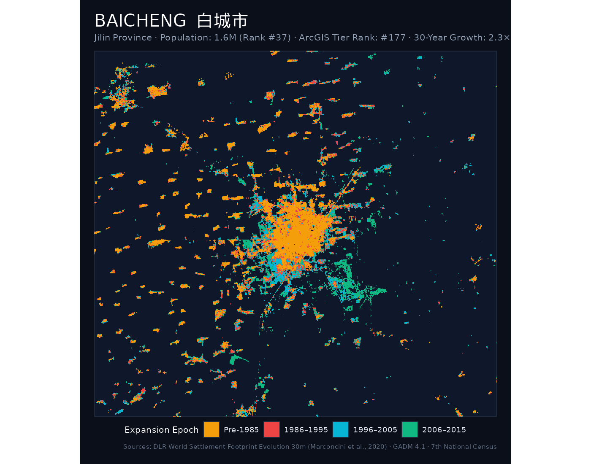
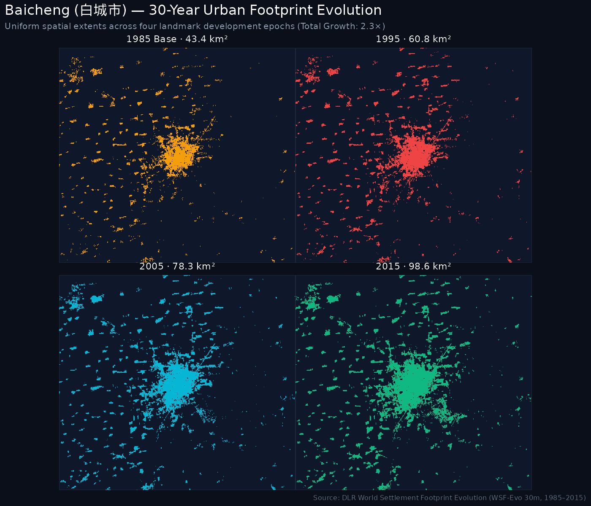
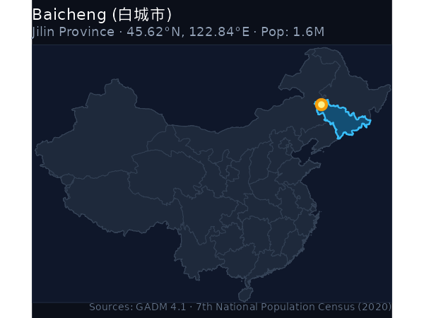
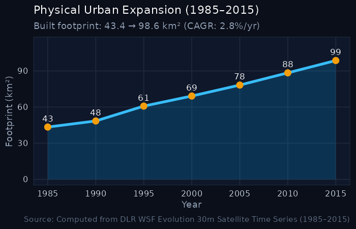

```{=html}
<div class="hero-banner">
  <div style="display: flex; justify-content: space-between; align-items: flex-start; flex-wrap: wrap; gap: 1rem;">
    <div>
      <h1 style="color: #ffffff; margin-bottom: 0.25rem;">Baicheng <span style="color: #f59e0b; font-weight: normal;">白城市</span></h1>
      <p style="color: #94a3b8; font-size: 1.1rem; margin: 0;">Báichéng · Jilin (吉林省) · Northeast Rust Belt</p>
      <p style="color: #cbd5e1; font-size: 0.95rem; margin-top: 0.35rem;">
        Population: <strong>1.55 Million</strong> (2020 Census) · 
        Population Rank: <strong>#37</strong> of 47 · 
        ArcGIS Urban Hierarchy Rank: <strong>#177</strong>
      </p>
    </div>
    <div style="text-align: right;">
      <span class="metric-badge badge-gold" style="font-size: 1.1rem; padding: 0.5rem 1rem;">2.27× Growth Multiplier</span>
    </div>
  </div>
</div>
```

## Key Urban Expansion & Hierarchy Indicators

::: {.metric-grid}
::: {.metric-card}
::: {.metric-label}
2020 Population
:::
::: {.metric-val}
1.55 <span style="font-size: 1rem; color: #94a3b8;">M</span>
:::
<div style="font-size: 0.8rem; color: #38bdf8;">Pop Rank #37 of 47</div>
:::

::: {.metric-card}
::: {.metric-label}
ArcGIS City Rank
:::
::: {.metric-val}
#177
:::
<div style="font-size: 0.8rem; color: #94a3b8;">National Big Cities Tier</div>
:::

::: {.metric-card}
::: {.metric-label}
1985 Baseline Area
:::
::: {.metric-val}
43.41 <span style="font-size: 1rem; color: #94a3b8;">km²</span>
:::
:::

::: {.metric-card}
::: {.metric-label}
2015 Urban Footprint
:::
::: {.metric-val}
98.62 <span style="font-size: 1rem; color: #94a3b8;">km²</span>
:::
<div style="font-size: 0.8rem; color: #10b981;">+55.21 km²</div>
:::

::: {.metric-card}
::: {.metric-label}
Growth Multiple
:::
::: {.metric-val}
2.27×
:::
<div style="font-size: 0.8rem; color: #f59e0b;">Multiplier Rank #42</div>
:::

::: {.metric-card}
::: {.metric-label}
Annual Growth (CAGR)
:::
::: {.metric-val}
2.77%
:::
<div style="font-size: 0.8rem; color: #94a3b8;">1985–2015</div>
:::
:::

---

## 1. The Urban Growth Rings (1985–2015)

The cartographic poster below maps the physical settlement rings of **Baicheng** across four historical development epochs:

- <span style="color: #F59E0B; font-weight: bold;">● Pre-1985 Core</span>: Historic urban core and initial post-1949 industrial settlements.
- <span style="color: #EF4444; font-weight: bold;">● 1986–1995 Wave</span>: Early reform, opening up, and Deng Xiaoping's 1992 Southern Tour (*Nanxun*).
- <span style="color: #06B6D4; font-weight: bold;">● 1996–2005 Wave</span>: WTO entry, export industrialization, and new development zones (*Kaifaqu*).
- <span style="color: #10B981; font-weight: bold;">● 2006–2015 Wave</span>: High-speed rail expansion, modern new cities (*Xinqu*), and peri-urban consolidation.

::: {.map-container}

:::

---

## 2. Small Multiples: 4-Epoch Footprint Progression

Uniform-scale physical footprint progression maps tracking built-up settlement expansion over time:

::: {.map-container}

:::

---

## 3. Geographical Location & Growth Trajectory

:::: {.columns}

::: {.column width="48%"}
### Location in China
::: {.map-container}

:::
:::

::: {.column width="4%"}
:::

::: {.column width="48%"}
### 30-Year Expansion Curve
::: {.map-container}

:::
:::

::::

---

## 4. 5-Year Milestone Chronology

| Milestone Year | Urban Footprint (km²) | Growth vs. 1985 Baseline | Share of 2015 Footprint |
|:---:|:---:|:---:|:---:|
| **1985** | 43.41 km² | 1.00× (Baseline) | 44.0% |
| **1990** | 48.47 km² | 1.12× | 49.1% |
| **1995** | 60.8 km² | 1.4× | 61.7% |
| **2000** | 69.17 km² | 1.59× | 70.1% |
| **2005** | 78.27 km² | 1.8× | 79.4% |
| **2010** | 88.4 km² | 2.04× | 89.6% |
| **2015** | 98.62 km² | **2.27×** | 100.0% |

---

## 5. Data Sources & Attributions

The quantitative and spatial indicators for **Baicheng** are synthesized from the following primary sources:

1. **Urban Footprint & Built-Up Surface**: German Aerospace Center (DLR) [World Settlement Footprint Evolution (1985–2015)](https://download.geoservice.dlr.de/WSF_EVO/). 30m resolution multi-decadal satellite detection (*Marconcini et al., 2020, Nature Scientific Data*).
2. **Permanent Resident Population**: National Bureau of Statistics of China (NBS), [Seventh National Population Census (第七次全国人口普查 / 七普 2020)](http://www.stats.gov.cn/). Resident population: **1.55M** (National Rank: **#37** of 47).
3. **National Urban Tier Classification**: Esri / [ArcGIS Online Big Cities Points FeatureServer](https://services1.arcgis.com/4TXrdeWh0RyCqPgB/arcgis/rest/services/big_cities_points/FeatureServer), National City Rank: **#177** of 184 major Chinese cities.
4. **Transit & High-Speed Rail Corridors**: Humanitarian OpenStreetMap Team (HOTOSM) & UN OCHA, [Railways of China Dataset](https://data.humdata.org/dataset/hotosm_chn_railways) on HDX, licensed under Open Database License (ODbL).
5. **Administrative Boundaries**: [GADM Database of Global Administrative Areas (v4.1)](https://gadm.org/), University of California, Davis.

---

```{=html}
<div style="display: flex; justify-content: space-between; margin-top: 2rem; padding: 1rem; background: #111827; border-radius: 8px;">
  <a href="fuxin.html" style="color: #38bdf8; text-decoration: none;">← Prev: Fuxin (1.65M)</a>
  <a href="../regions/northeast.html" style="color: #f59e0b; text-decoration: none;">↑ Northeast Rust Belt</a>
  <a href="zhangjiajie.html" style="color: #38bdf8; text-decoration: none;">Next: Zhangjiajie (1.52M) →</a>
</div>
```
