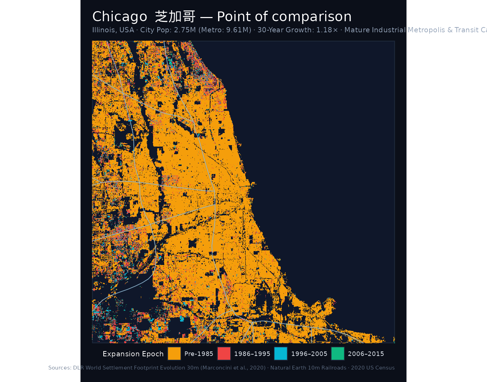
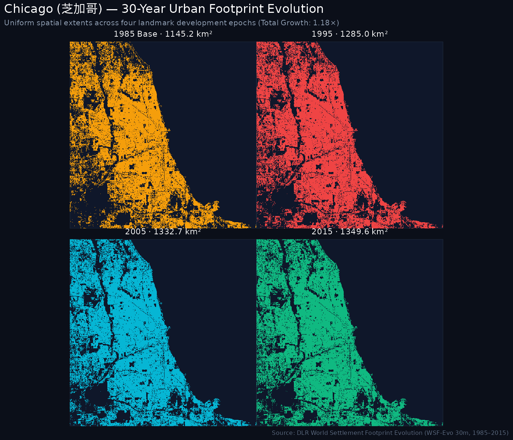
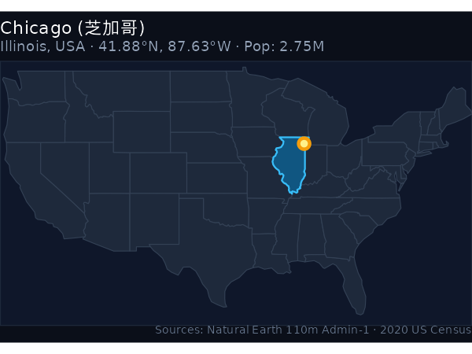
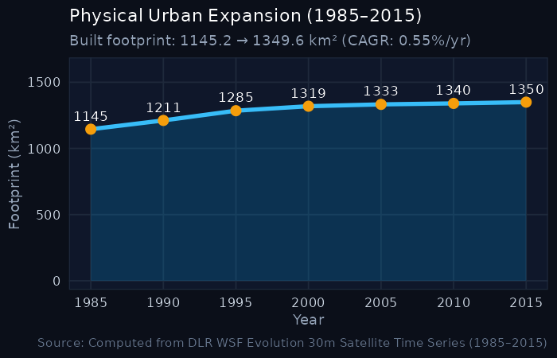

```{=html}
<div class="hero-banner">
  <div style="display: flex; justify-content: space-between; align-items: flex-start; flex-wrap: wrap; gap: 1rem;">
    <div>
      <div style="display: inline-block; padding: 0.2rem 0.6rem; background: #943324; color: white; border-radius: 3px; font-size: 0.8rem; font-weight: 600; margin-bottom: 0.5rem; font-family: -apple-system, sans-serif;">Point of comparison · US benchmark</div>
      <h1 class="hero-title" style="margin-bottom: 0.25rem;">Chicago <span style="color: #1e3f34; font-weight: normal; font-style: normal;">芝加哥</span></h1>
      <p style="color: #5e524a; font-size: 1.1rem; margin: 0; font-style: italic;">Illinois, United States · US Midwest & Great Lakes · Archetype: Mature Industrial Metropolis & Transit Capital</p>
      <p style="color: #221d1a; font-size: 0.95rem; margin-top: 0.35rem;">
        Population: <strong>2.75M</strong> (City proper) · <strong>9.61M</strong> (Metropolitan area) · 
        Comparative peer: <strong>Xi'an / Wuhan / Harbin</strong>
      </p>
      <div style="margin-top: 0.75rem; display: flex; flex-wrap: wrap; gap: 0.5rem;">
        <a href="https://en.wikipedia.org/wiki/Chicago" target="_blank" rel="noopener" class="resource-btn">Wikipedia (EN)</a>
        <a href="https://zh.wikipedia.org/wiki/芝加哥" target="_blank" rel="noopener" class="resource-btn">维基百科 (ZH)</a>
        <a href="https://www.wikidata.org" target="_blank" rel="noopener" class="resource-btn">Wikidata (Q)</a>
        <a href="https://commons.wikimedia.org/wiki/Category:Maps_of_Chicago" target="_blank" rel="noopener" class="resource-btn">Wikimedia Commons</a>
        <a href="https://commons.wikimedia.org/w/index.php?search=Chicago+map" target="_blank" rel="noopener" class="resource-btn">Scanned maps search</a>
        <a href="https://drive.google.com/drive/folders/1b-HupghVS7KQn4ZTvGjfOHFFMgPnH2KV?usp=sharing" target="_blank" rel="noopener" class="resource-btn" style="background: #e8ded1; border-color: #943324; font-weight: 600;">AGSL map scans archive ↗</a>
        <a href="https://ucsb.maps.arcgis.com/home/item.html?id=636bb82ea14944a5b719fc46cf055a53#overview" target="_blank" rel="noopener" class="resource-btn" style="background: #e8ded1; border-color: #943324; font-weight: 600;">UCSB Esri Web Map ↗</a>
      </div>
    </div>
    <div style="text-align: right;">
      <span class="metric-badge badge-gold" style="font-size: 1.1rem; padding: 0.5rem 1rem;">1.18× growth multiple</span>
    </div>
  </div>
</div>
```

## 1. The urban expansion rings (1985–2015)

The cartographic monograph below maps the physical settlement expansion of **Chicago** across four landmark development epochs:

- <span style="color: #c75c3d; font-weight: bold;">● Pre-1985 Core</span>: Historic urban core and built-up metropolitan area established prior to 1985.
- <span style="color: #2e5a48; font-weight: bold;">● 1986–1995 Wave</span>: Late 20th-century suburbanization and commercial arterial growth.
- <span style="color: #457b9d; font-weight: bold;">● 1996–2005 Wave</span>: Turn-of-the-century suburban expansion, outer-ring residential developments, and exurban employment centers.
- <span style="color: #e9c46a; font-weight: bold;">● 2006–2015 Wave</span>: Recent outer beltway growth and peri-urban consolidation.

::: {.map-container}

:::

::: {.callout-note title="Point of Comparison: Benchmark Analysis"}
In 1985, Chicago's built footprint was an immense **1,145.18 km²**—larger than every single Chinese city analyzed in this atlas (e.g., nearly 3× the size of Xi'an or Zhengzhou, and 5.5× the size of Chengdu). Over the subsequent 30 years, Chicago expanded by +204.44 km² (a 1.18× multiplier, 0.55% CAGR).

While Chinese megacities like Xi'an (+961 km², 3.45×) and Wuhan (+798 km², 3.85×) experienced explosive radial outward expansion, Chicago demonstrates the spatial behavior of a mature, post-industrial Western colossus: incremental peripheral edge development, exurban infill along interstate highways and Metra commuter corridors, and gradual demographic consolidation around an already vast urbanized core.
:::

---

## 2. Four-epoch footprint progression

Uniform-scale physical footprint progression maps tracking built-up settlement expansion over time:

::: {.map-container}

:::

---

## 3. Geographical location & expansion trajectory

:::: {.columns}

::: {.column width="48%"}
### Location in the United States
::: {.map-container}

:::
:::

::: {.column width="4%"}
:::

::: {.column width="48%"}
### Thirty-year expansion curve
::: {.map-container}

:::
:::

::::

---

## 4. Urban expansion & hierarchy indicators

::: {.metric-grid}
::: {.metric-card}
::: {.metric-label}
2020 Population
:::
::: {.metric-val}
2.75 <span style="font-size: 1rem; color: #5e524a;">M</span>
:::
<div style="font-size: 0.8rem; color: #943324;">Metro CSA: 9.61M</div>
:::

::: {.metric-card}
::: {.metric-label}
Metropolitan Archetype
:::
::: {.metric-val}
Mature Industrial Metropolis
:::
<div style="font-size: 0.8rem; color: #5e524a;">US Growth Profile</div>
:::

::: {.metric-card}
::: {.metric-label}
1985 Baseline Area
:::
::: {.metric-val}
1145.18 <span style="font-size: 1rem; color: #5e524a;">km²</span>
:::
:::

::: {.metric-card}
::: {.metric-label}
2015 Urban Footprint
:::
::: {.metric-val}
1349.62 <span style="font-size: 1rem; color: #5e524a;">km²</span>
:::
<div style="font-size: 0.8rem; color: #1e3f34;">+204.44 km²</div>
:::

::: {.metric-card}
::: {.metric-label}
Growth Multiple
:::
::: {.metric-val}
1.18×
:::
<div style="font-size: 0.8rem; color: #943324;">30-Year Expansion Ratio</div>
:::

::: {.metric-card}
::: {.metric-label}
Annual Growth (CAGR)
:::
::: {.metric-val}
0.55%
:::
<div style="font-size: 0.8rem; color: #5e524a;">1985–2015</div>
:::
:::

---

## 5. Five-year milestone chronology

| Milestone Year | Urban Footprint (km²) | Growth vs. 1985 Baseline | Share of 2015 Footprint |
|:---:|:---:|:---:|:---:|
| **1985** | 1145.18 km² | 1.00× (Baseline) | 84.9% |
| **1990** | 1211.39 km² | 1.06× | 89.8% |
| **1995** | 1284.96 km² | 1.12× | 95.2% |
| **2000** | 1318.88 km² | 1.15× | 97.7% |
| **2005** | 1332.68 km² | 1.16× | 98.7% |
| **2010** | 1340.15 km² | 1.17× | 99.3% |
| **2015** | 1349.62 km² | **1.18×** | 100.0% |

---

## 6. Archival cartography & historical map scans

Direct links to open knowledge, semantic geodata, and scanned map collections for **Chicago**:

- 📖 **English Wikipedia**: [Chicago](https://en.wikipedia.org/wiki/Chicago) — In-depth overview of history, urban development, demographic shifts, and regional governance.
- 🌐 **Chinese Wikipedia (中文维基百科)**: [芝加哥](https://zh.wikipedia.org/wiki/芝加哥) — Authoritative municipal boundaries, administrative subdivisions, and local transport infrastructure.
- 🏷️ **Wikidata Knowledge Base**: [Q (Chicago)](https://www.wikidata.org) — Semantic knowledge graph entity with geocoordinates, OpenStreetMap tags, and linked administrative entities.
- 🗺️ **Wikimedia Commons Map Repository**: [Maps of Chicago](https://commons.wikimedia.org/wiki/Category:Maps_of_Chicago) — Community-curated media repository containing thematic, administrative, and transport maps.
- 🔍 **Scanned Maps & Historical Sheets Search**: [Explore scanned bitmap and topographic maps of Chicago on Wikimedia Commons](https://commons.wikimedia.org/w/index.php?search=Chicago+map)
- 🗄️ **AGSL Historical Map Archive**: [Access Google Drive repository of AGSL scans](https://drive.google.com/drive/folders/1b-HupghVS7KQn4ZTvGjfOHFFMgPnH2KV?usp=sharing)
- 🌐 **UCSB ArcGIS Online Web Map**: [View interactive Web Map (item 636bb82ea14944a5b719fc46cf055a53)](https://ucsb.maps.arcgis.com/home/item.html?id=636bb82ea14944a5b719fc46cf055a53#overview)

---

## 7. Sources & methodology attributions

The quantitative and spatial indicators for **Chicago** are synthesized from the following primary sources:

1. **Urban Footprint & Built-Up Surface**: German Aerospace Center (DLR) [World Settlement Footprint Evolution (1985–2015)](https://download.geoservice.dlr.de/WSF_EVO/). 30m resolution multi-decadal satellite detection (*Marconcini et al., 2020, Nature Scientific Data*).
2. **Resident & Metropolitan Population**: U.S. Census Bureau, [2020 Decennial Census of Population and Housing](https://www.census.gov/). City population: **2.75M**; Metropolitan statistical area: **9.61M**.
3. **Rail & Transit Corridors**: Natural Earth 1:10,000,000 North America Railroads and passenger transit agency records.
4. **Administrative Boundaries**: Natural Earth Admin-1 State and Province Boundaries.
5. **Archival Cartography & Historical Surveys**: American Geographical Society Library (AGSL) Map Collection & [Wikimedia Foundation](https://www.wikimedia.org/) ([Wikipedia](https://en.wikipedia.org/), [Wikidata](https://www.wikidata.org/), and [Wikimedia Commons](https://commons.wikimedia.org/)).

---

```{=html}
<div style="display: flex; justify-content: space-between; margin-top: 2rem; padding: 1rem; background: #f4efe4; border: 1px solid #d6ccbe; border-radius: 4px;">
  <a href="charlotte.html" style="color: #943324; text-decoration: none; font-weight: 600;">← Previous: Charlotte (0.87M)</a>
  <a href="../comparison.html" style="color: #1e3f34; text-decoration: none; font-weight: 600;">↑ All US comparison benchmarks</a>
  <a href="milwaukee.html" style="color: #943324; text-decoration: none; font-weight: 600;">Next: Milwaukee (0.58M) →</a>
</div>
```
