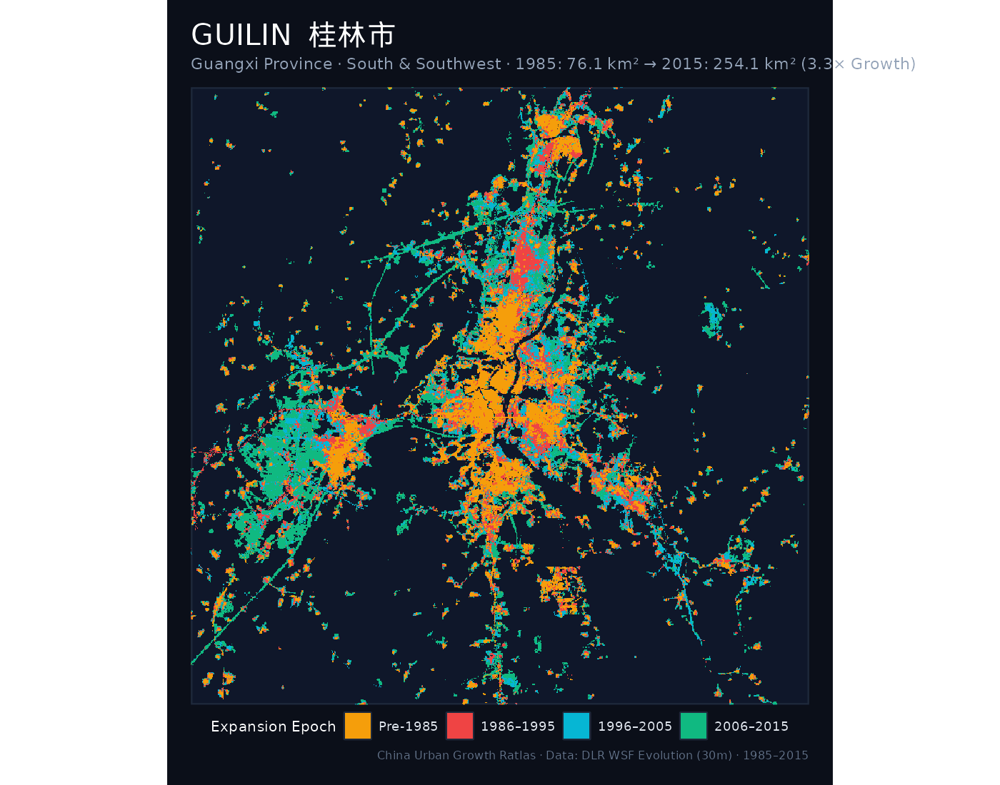
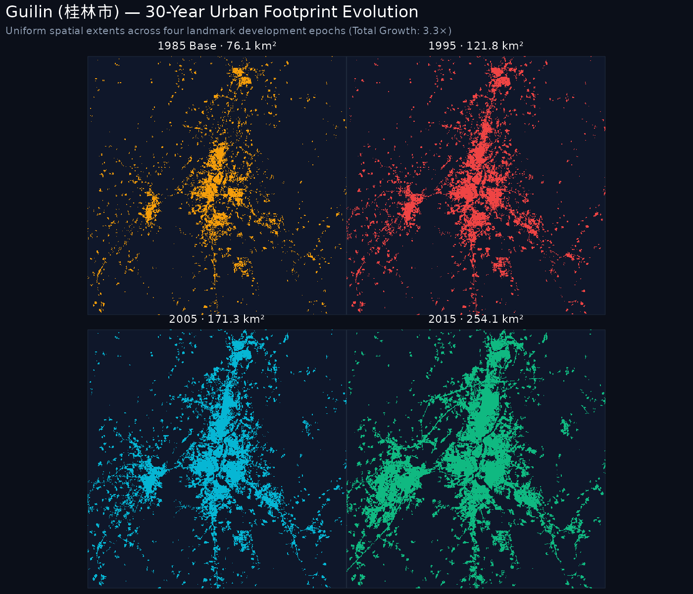
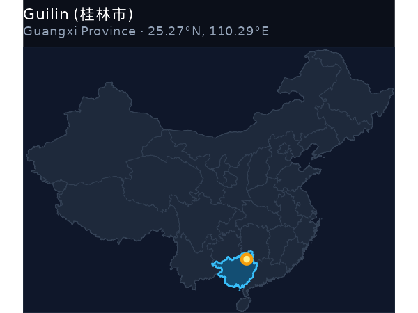
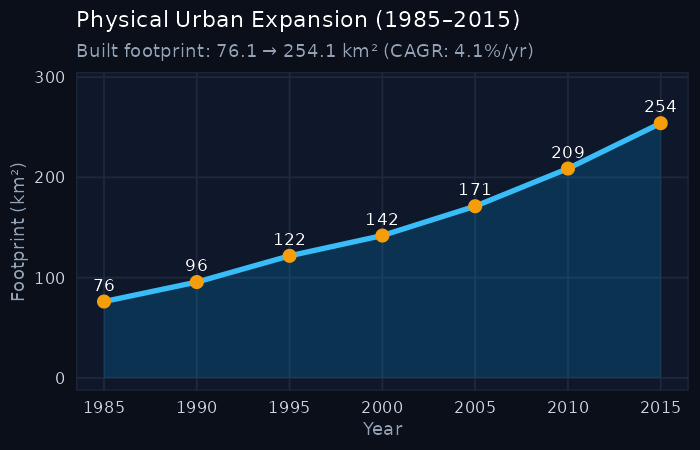

::: {.hero-banner}

  

    <h1 style="color: #ffffff; margin-bottom: 0.25rem;">Guilin 桂林市</h1>
    
Guìlín · Guangxi Province · National Rank: <strong>#29</strong> of 47

  

  

    3.34× Multiplier
  

:::

## Key Expansion Indicators (1985–2015)

::: {.metric-grid}
::: {.metric-card}
::: {.metric-label}
1985 Baseline Area
:::
::: {.metric-val}
76.14 km²
:::
:::

::: {.metric-card}
::: {.metric-label}
2015 Urban Footprint
:::
::: {.metric-val}
254.1 km²
:::
:::

::: {.metric-card}
::: {.metric-label}
Net Surface Gain
:::
::: {.metric-val}
+177.96 km²
:::
:::

::: {.metric-card}
::: {.metric-label}
Growth Multiple
:::
::: {.metric-val}
3.34×
:::
:::

::: {.metric-card}
::: {.metric-label}
Annual Growth (CAGR)
:::
::: {.metric-val}
4.1%
:::
:::
:::

---

## 1. The Urban Growth Rings (1985–2015)

The primary cartographic poster below visualizes the physical expansion rings of **Guilin**, partitioned into four milestone eras:

- ● Pre-1985: Historic core and initial post-1949 development.
- ● 1986–1995: Early reform, opening up, and Deng Xiaoping's southern tour.
- ● 1996–2005: WTO entry, export boom, and new industrial development zones.
- ● 2006–2015: High-speed rail expansion, modern new towns (*xinqu*), and peri-urban consolidation.

::: {.map-container}

:::

---

## 2. Small Multiples: 4-Epoch Footprint Evolution

Comparative uniform-scale footprint maps isolating the cumulative urbanized surface across the four key epochs:

::: {.map-container}

:::

---

## 3. Geographical Context & Growth Trajectory

:::: {.columns}

::: {.column width="48%"}
### National Location
::: {.map-container}

:::
:::

::: {.column width="4%"}
:::

::: {.column width="48%"}
### 30-Year Expansion Curve
::: {.map-container}

:::
:::

::::

---

## 4. 5-Year Milestone Chronology

The table below catalogs the cumulative built-up surface area of Guilin at 5-year intervals:

| Milestone Year | Urban Footprint (km²) | Growth vs. 1985 Baseline | Share of 2015 Footprint |
|:---:|:---:|:---:|:---:|
| **1985** | 76.14 km² | 1.00× (Baseline) | 30.0% |
| **1990** | 95.58 km² | 1.26× | 37.6% |
| **1995** | 121.75 km² | 1.6× | 47.9% |
| **2000** | 141.99 km² | 1.86× | 55.9% |
| **2005** | 171.26 km² | 2.25× | 67.4% |
| **2010** | 208.85 km² | 2.74× | 82.2% |
| **2015** | 254.1 km² | **3.34×** | 100.0% |

---

  <a href="nanchang.html" style="color: #38bdf8; text-decoration: none;">← Previous: Nanchang (南昌市)</a>
  <a href="../regions/western_frontier.html" style="color: #f59e0b; text-decoration: none;">↑ South & Southwest</a>
  <a href="liaocheng.html" style="color: #38bdf8; text-decoration: none;">Next: Liaocheng (聊城市) →</a>

