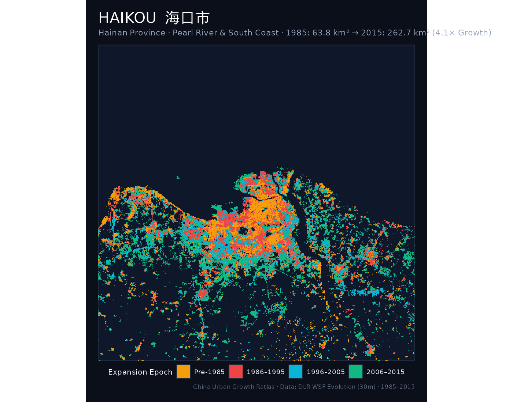
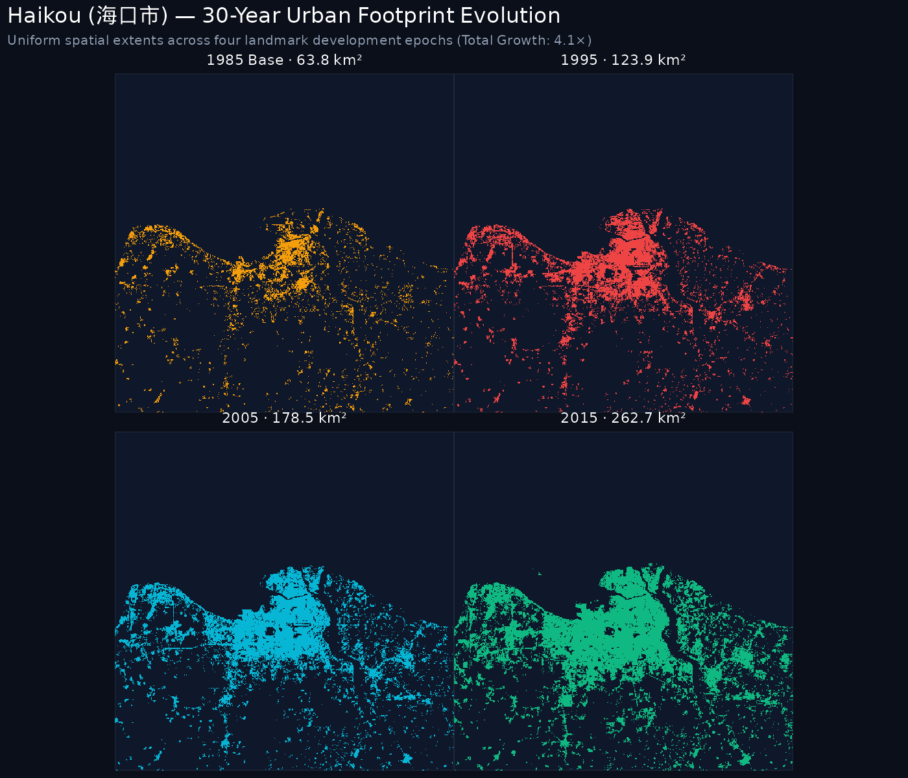
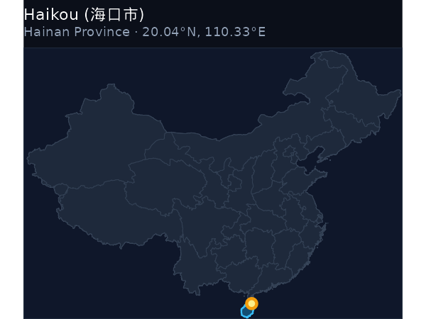
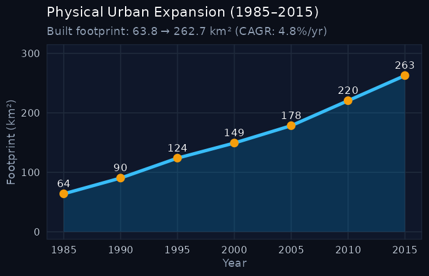

::: {.hero-banner}

  

    <h1 style="color: #ffffff; margin-bottom: 0.25rem;">Haikou 海口市</h1>
    
Hǎikǒu · Hainan Province · National Rank: <strong>#14</strong> of 47

  

  

    4.12× Multiplier
  

:::

## Key Expansion Indicators (1985–2015)

::: {.metric-grid}
::: {.metric-card}
::: {.metric-label}
1985 Baseline Area
:::
::: {.metric-val}
63.84 km²
:::
:::

::: {.metric-card}
::: {.metric-label}
2015 Urban Footprint
:::
::: {.metric-val}
262.73 km²
:::
:::

::: {.metric-card}
::: {.metric-label}
Net Surface Gain
:::
::: {.metric-val}
+198.89 km²
:::
:::

::: {.metric-card}
::: {.metric-label}
Growth Multiple
:::
::: {.metric-val}
4.12×
:::
:::

::: {.metric-card}
::: {.metric-label}
Annual Growth (CAGR)
:::
::: {.metric-val}
4.83%
:::
:::
:::

---

## 1. The Urban Growth Rings (1985–2015)

The primary cartographic poster below visualizes the physical expansion rings of **Haikou**, partitioned into four milestone eras:

- ● Pre-1985: Historic core and initial post-1949 development.
- ● 1986–1995: Early reform, opening up, and Deng Xiaoping's southern tour.
- ● 1996–2005: WTO entry, export boom, and new industrial development zones.
- ● 2006–2015: High-speed rail expansion, modern new towns (*xinqu*), and peri-urban consolidation.

::: {.map-container}

:::

---

## 2. Small Multiples: 4-Epoch Footprint Evolution

Comparative uniform-scale footprint maps isolating the cumulative urbanized surface across the four key epochs:

::: {.map-container}

:::

---

## 3. Geographical Context & Growth Trajectory

:::: {.columns}

::: {.column width="48%"}
### National Location
::: {.map-container}

:::
:::

::: {.column width="4%"}
:::

::: {.column width="48%"}
### 30-Year Expansion Curve
::: {.map-container}

:::
:::

::::

---

## 4. 5-Year Milestone Chronology

The table below catalogs the cumulative built-up surface area of Haikou at 5-year intervals:

| Milestone Year | Urban Footprint (km²) | Growth vs. 1985 Baseline | Share of 2015 Footprint |
|:---:|:---:|:---:|:---:|
| **1985** | 63.84 km² | 1.00× (Baseline) | 24.3% |
| **1990** | 90.34 km² | 1.42× | 34.4% |
| **1995** | 123.88 km² | 1.94× | 47.2% |
| **2000** | 149.27 km² | 2.34× | 56.8% |
| **2005** | 178.46 km² | 2.8× | 67.9% |
| **2010** | 220.49 km² | 3.45× | 83.9% |
| **2015** | 262.73 km² | **4.12×** | 100.0% |

---

  <a href="huangshan.html" style="color: #38bdf8; text-decoration: none;">← Previous: Huangshan (黄山市)</a>
  <a href="../regions/coastal_south.html" style="color: #f59e0b; text-decoration: none;">↑ Pearl River & South Coast</a>
  <a href="kunming.html" style="color: #38bdf8; text-decoration: none;">Next: Kunming (昆明市) →</a>

