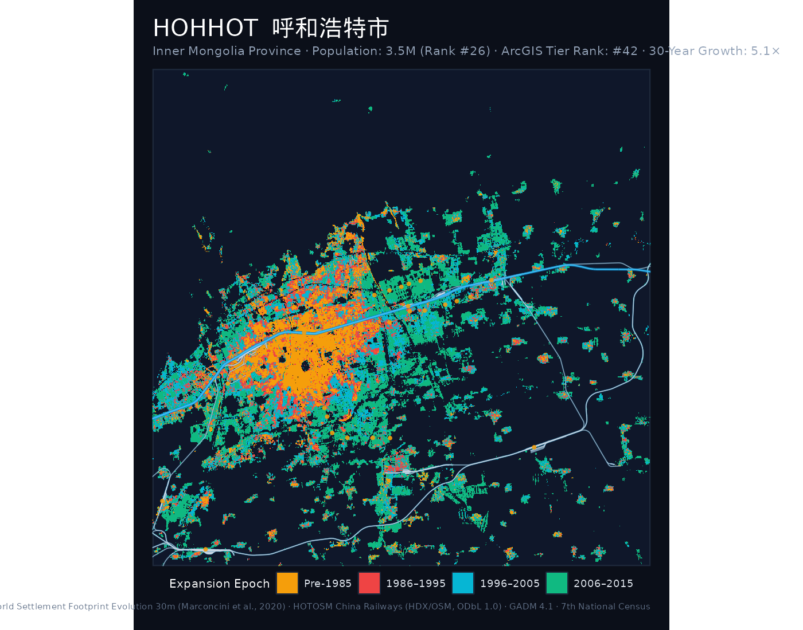
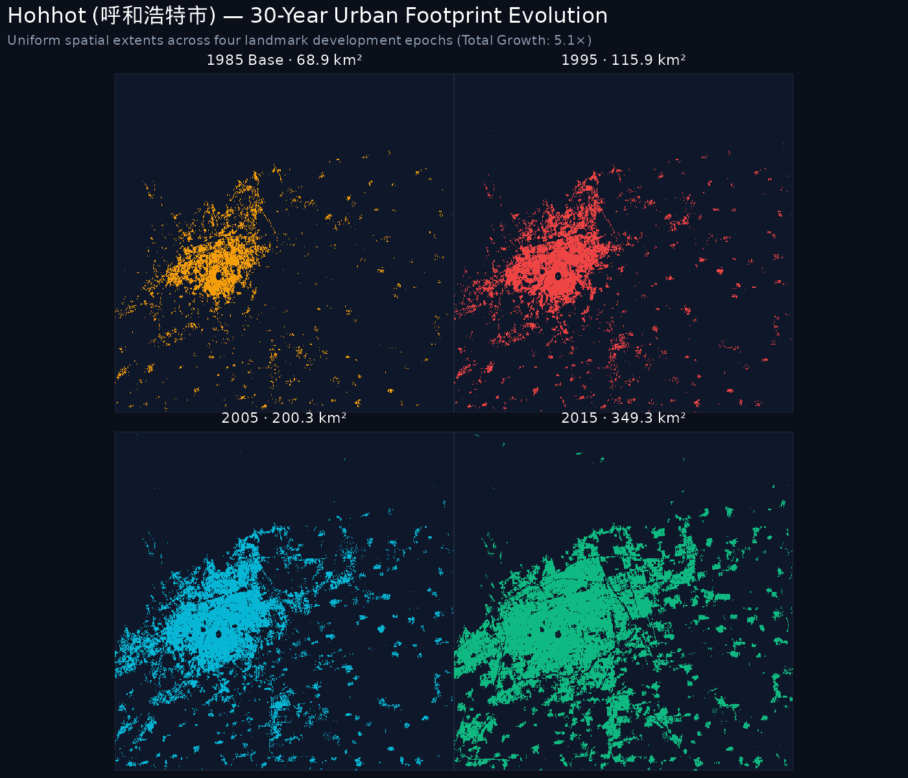
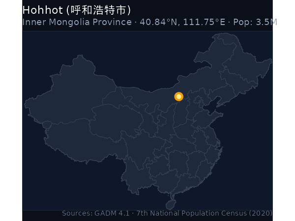
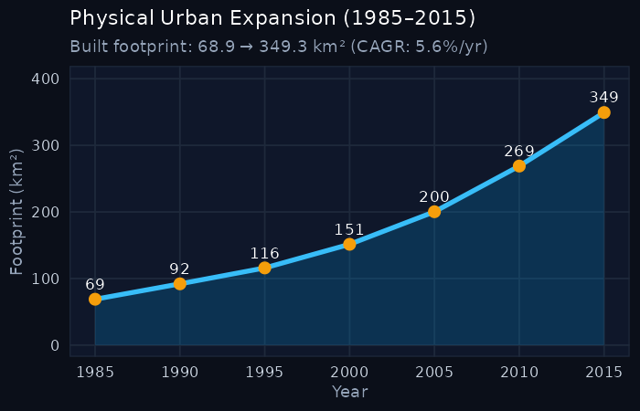

```{=html}
<div class="hero-banner">
  <div style="display: flex; justify-content: space-between; align-items: flex-start; flex-wrap: wrap; gap: 1rem;">
    <div>
      <h1 style="color: #ffffff; margin-bottom: 0.25rem;">Hohhot <span style="color: #f59e0b; font-weight: normal;">呼和浩特市</span></h1>
      <p style="color: #94a3b8; font-size: 1.1rem; margin: 0;">Hūhéhàotè · Inner Mongolia (内蒙古自治区) · Western Frontier & Steppe</p>
      <p style="color: #cbd5e1; font-size: 0.95rem; margin-top: 0.35rem;">Population: <strong>3.45 Million</strong> (2020 Census) · National Rank: <strong>#26</strong> of 47</p>
    </div>
    <div style="text-align: right;">
      <span class="metric-badge badge-gold" style="font-size: 1.1rem; padding: 0.5rem 1rem;">5.07× Growth Multiplier</span>
    </div>
  </div>
</div>
```

## Key Urban Expansion Indicators

::: {.metric-grid}
::: {.metric-card}
::: {.metric-label}
2020 Population
:::
::: {.metric-val}
3.45 <span style="font-size: 1rem; color: #94a3b8;">M</span>
:::
<div style="font-size: 0.8rem; color: #38bdf8;">Rank #26 of 47</div>
:::

::: {.metric-card}
::: {.metric-label}
1985 Baseline Area
:::
::: {.metric-val}
68.88 <span style="font-size: 1rem; color: #94a3b8;">km²</span>
:::
:::

::: {.metric-card}
::: {.metric-label}
2015 Urban Footprint
:::
::: {.metric-val}
349.27 <span style="font-size: 1rem; color: #94a3b8;">km²</span>
:::
<div style="font-size: 0.8rem; color: #10b981;">+280.39 km²</div>
:::

::: {.metric-card}
::: {.metric-label}
Growth Multiple
:::
::: {.metric-val}
5.07×
:::
<div style="font-size: 0.8rem; color: #f59e0b;">Rank #9 of 47</div>
:::

::: {.metric-card}
::: {.metric-label}
Annual Growth (CAGR)
:::
::: {.metric-val}
5.56%
:::
<div style="font-size: 0.8rem; color: #94a3b8;">1985–2015</div>
:::
:::

---

## 1. The Urban Growth Rings (1985–2015)

The cartographic poster below maps the physical settlement rings of **Hohhot** across four historical development epochs:

- <span style="color: #F59E0B; font-weight: bold;">● Pre-1985 Core</span>: Historic urban core and initial post-1949 industrial settlements.
- <span style="color: #EF4444; font-weight: bold;">● 1986–1995 Wave</span>: Early reform, opening up, and Deng Xiaoping's 1992 Southern Tour (*Nanxun*).
- <span style="color: #06B6D4; font-weight: bold;">● 1996–2005 Wave</span>: WTO entry, export industrialization, and new development zones (*Kaifaqu*).
- <span style="color: #10B981; font-weight: bold;">● 2006–2015 Wave</span>: High-speed rail expansion, modern new cities (*Xinqu*), and peri-urban consolidation.

::: {.map-container}

:::

---

## 2. Small Multiples: 4-Epoch Footprint Progression

Uniform-scale physical footprint progression maps tracking built-up settlement expansion over time:

::: {.map-container}

:::

---

## 3. Geographical Location & Growth Trajectory

:::: {.columns}

::: {.column width="48%"}
### Location in China
::: {.map-container}

:::
:::

::: {.column width="4%"}
:::

::: {.column width="48%"}
### 30-Year Expansion Curve
::: {.map-container}

:::
:::

::::

---

## 4. 5-Year Milestone Chronology

| Milestone Year | Urban Footprint (km²) | Growth vs. 1985 Baseline | Share of 2015 Footprint |
|:---:|:---:|:---:|:---:|
| **1985** | 68.88 km² | 1.00× (Baseline) | 19.7% |
| **1990** | 92 km² | 1.34× | 26.3% |
| **1995** | 115.91 km² | 1.68× | 33.2% |
| **2000** | 151.39 km² | 2.2× | 43.3% |
| **2005** | 200.28 km² | 2.91× | 57.3% |
| **2010** | 268.89 km² | 3.9× | 77.0% |
| **2015** | 349.27 km² | **5.07×** | 100.0% |

---

```{=html}
<div style="display: flex; justify-content: space-between; margin-top: 2rem; padding: 1rem; background: #111827; border-radius: 8px;">
  <a href="wuhu.html" style="color: #38bdf8; text-decoration: none;">← Prev: Wuhu (3.64M)</a>
  <a href="../regions/western_frontier.html" style="color: #f59e0b; text-decoration: none;">↑ Western Frontier & Steppe</a>
  <a href="datong.html" style="color: #38bdf8; text-decoration: none;">Next: Datong (3.11M) →</a>
</div>
```
