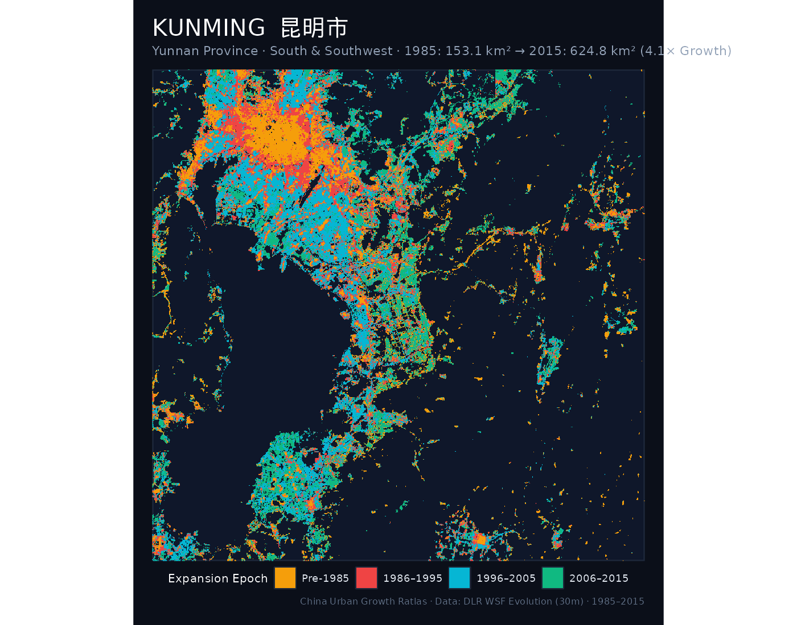
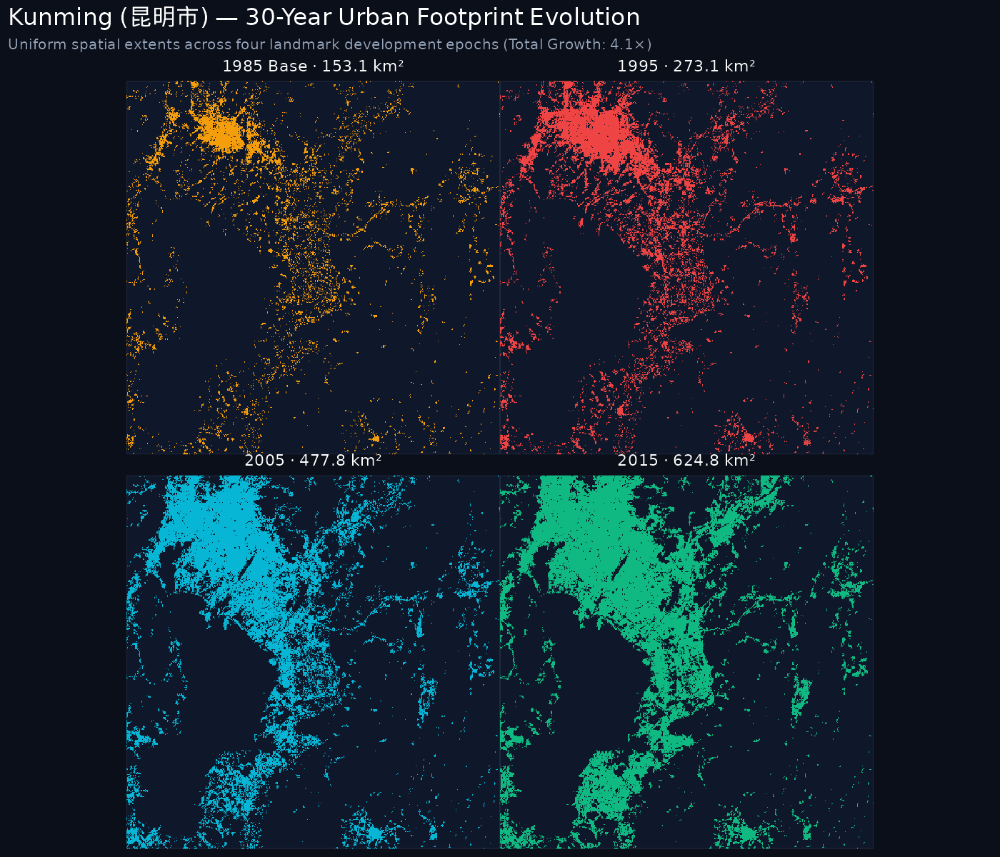
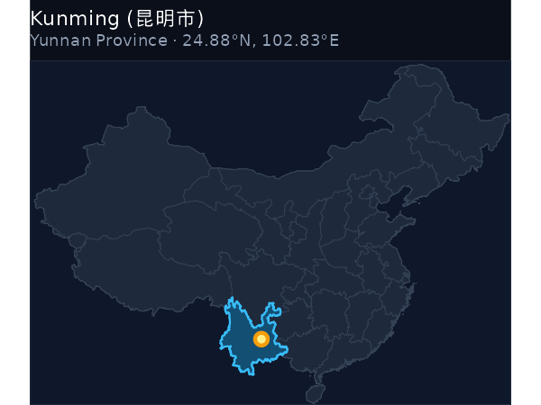
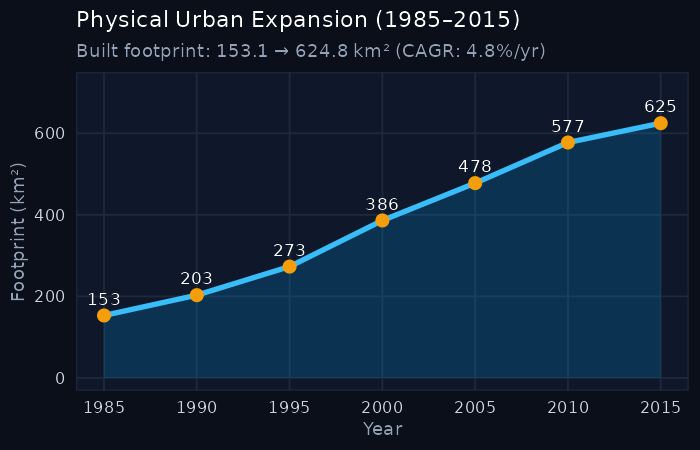

::: {.hero-banner}

  

    <h1 style="color: #ffffff; margin-bottom: 0.25rem;">Kunming 昆明市</h1>
    
Kūnmíng · Yunnan Province · National Rank: <strong>#15</strong> of 47

  

  

    4.08× Multiplier
  

:::

## Key Expansion Indicators (1985–2015)

::: {.metric-grid}
::: {.metric-card}
::: {.metric-label}
1985 Baseline Area
:::
::: {.metric-val}
153.06 km²
:::
:::

::: {.metric-card}
::: {.metric-label}
2015 Urban Footprint
:::
::: {.metric-val}
624.84 km²
:::
:::

::: {.metric-card}
::: {.metric-label}
Net Surface Gain
:::
::: {.metric-val}
+471.78 km²
:::
:::

::: {.metric-card}
::: {.metric-label}
Growth Multiple
:::
::: {.metric-val}
4.08×
:::
:::

::: {.metric-card}
::: {.metric-label}
Annual Growth (CAGR)
:::
::: {.metric-val}
4.8%
:::
:::
:::

---

## 1. The Urban Growth Rings (1985–2015)

The primary cartographic poster below visualizes the physical expansion rings of **Kunming**, partitioned into four milestone eras:

- ● Pre-1985: Historic core and initial post-1949 development.
- ● 1986–1995: Early reform, opening up, and Deng Xiaoping's southern tour.
- ● 1996–2005: WTO entry, export boom, and new industrial development zones.
- ● 2006–2015: High-speed rail expansion, modern new towns (*xinqu*), and peri-urban consolidation.

::: {.map-container}

:::

---

## 2. Small Multiples: 4-Epoch Footprint Evolution

Comparative uniform-scale footprint maps isolating the cumulative urbanized surface across the four key epochs:

::: {.map-container}

:::

---

## 3. Geographical Context & Growth Trajectory

:::: {.columns}

::: {.column width="48%"}
### National Location
::: {.map-container}

:::
:::

::: {.column width="4%"}
:::

::: {.column width="48%"}
### 30-Year Expansion Curve
::: {.map-container}

:::
:::

::::

---

## 4. 5-Year Milestone Chronology

The table below catalogs the cumulative built-up surface area of Kunming at 5-year intervals:

| Milestone Year | Urban Footprint (km²) | Growth vs. 1985 Baseline | Share of 2015 Footprint |
|:---:|:---:|:---:|:---:|
| **1985** | 153.06 km² | 1.00× (Baseline) | 24.5% |
| **1990** | 202.94 km² | 1.33× | 32.5% |
| **1995** | 273.06 km² | 1.78× | 43.7% |
| **2000** | 386.19 km² | 2.52× | 61.8% |
| **2005** | 477.82 km² | 3.12× | 76.5% |
| **2010** | 577.46 km² | 3.77× | 92.4% |
| **2015** | 624.84 km² | **4.08×** | 100.0% |

---

  <a href="haikou.html" style="color: #38bdf8; text-decoration: none;">← Previous: Haikou (海口市)</a>
  <a href="../regions/western_frontier.html" style="color: #f59e0b; text-decoration: none;">↑ South & Southwest</a>
  <a href="dongying.html" style="color: #38bdf8; text-decoration: none;">Next: Dongying (东营市) →</a>

