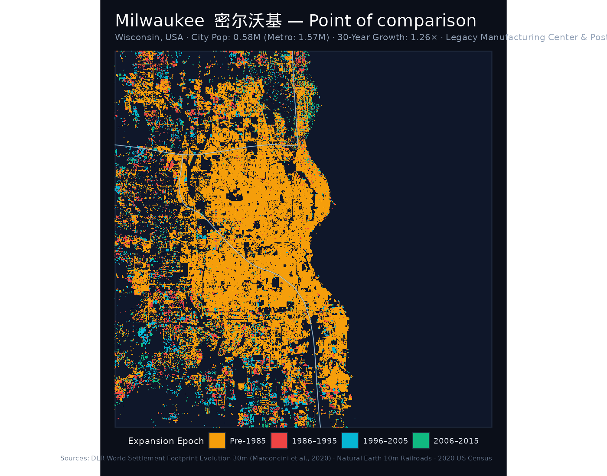
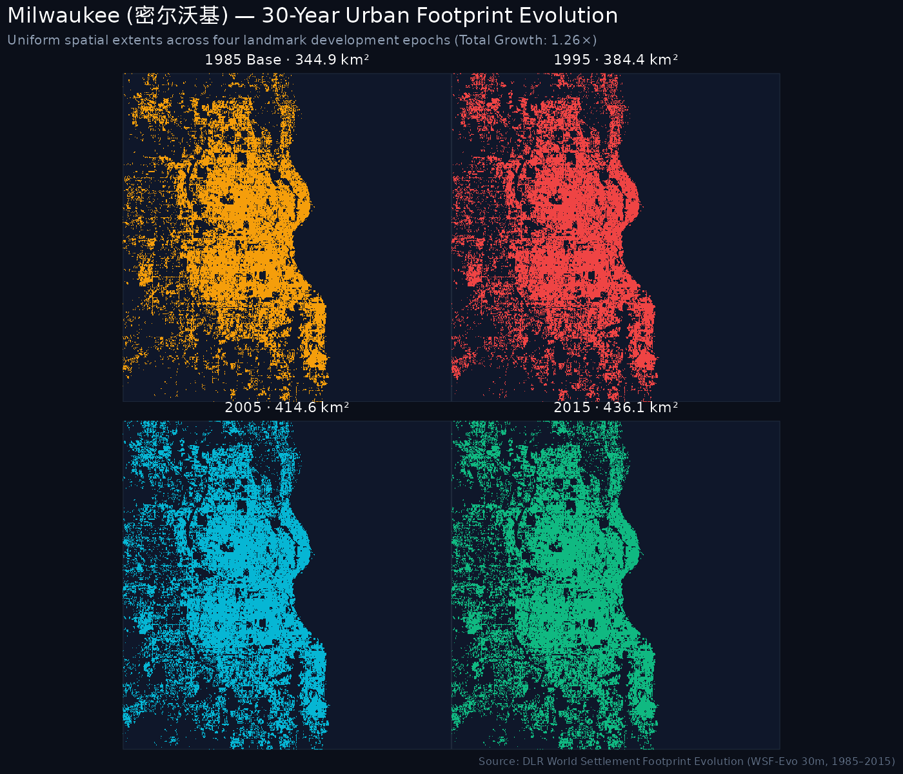
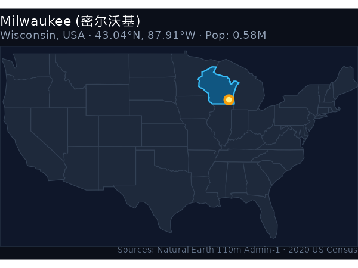
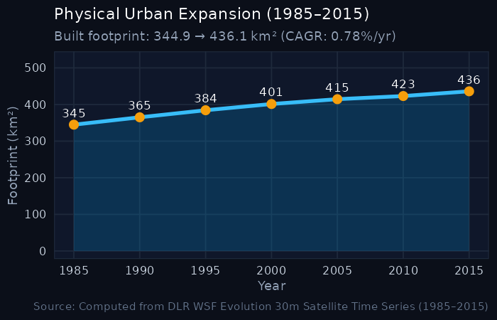

```{=html}
<div class="hero-banner">
  <div style="display: flex; justify-content: space-between; align-items: flex-start; flex-wrap: wrap; gap: 1rem;">
    <div>
      <div style="display: inline-block; padding: 0.2rem 0.6rem; background: #0284c7; color: white; border-radius: 4px; font-size: 0.8rem; font-weight: 600; margin-bottom: 0.5rem;">POINT OF COMPARISON (US BENCHMARK)</div>
      <h1 style="color: #ffffff; margin-bottom: 0.25rem;">Milwaukee <span style="color: #f59e0b; font-weight: normal;">密尔沃基</span></h1>
      <p style="color: #94a3b8; font-size: 1.1rem; margin: 0;">Wisconsin, United States · US Great Lakes Rust Belt · Archetype: Legacy Manufacturing Center & Post-Industrial Core</p>
      <p style="color: #cbd5e1; font-size: 0.95rem; margin-top: 0.35rem;">
        Population: <strong>0.58M</strong> (City Proper) · <strong>1.57M</strong> (Metropolitan Area) · 
        Comparative Peer: <strong>Northeast Rust Belt (Fuxin / Dandong / Tieling)</strong>
      </p>
      <div style="margin-top: 0.75rem; display: flex; flex-wrap: wrap; gap: 0.5rem;">
        <a href="https://en.wikipedia.org/wiki/Milwaukee" target="_blank" rel="noopener" class="resource-btn">📖 Wikipedia (EN)</a>
        <a href="https://zh.wikipedia.org/wiki/密尔沃基" target="_blank" rel="noopener" class="resource-btn">🌐 维基百科 (ZH)</a>
        <a href="https://www.wikidata.org" target="_blank" rel="noopener" class="resource-btn">🏷️ Wikidata (Q)</a>
        <a href="https://commons.wikimedia.org/wiki/Category:Maps_of_Milwaukee" target="_blank" rel="noopener" class="resource-btn">🗺️ Commons Maps</a>
        <a href="https://commons.wikimedia.org/w/index.php?search=Milwaukee+map" target="_blank" rel="noopener" class="resource-btn">🔍 Scanned Maps</a>
      </div>
    </div>
    <div style="text-align: right;">
      <span class="metric-badge badge-gold" style="font-size: 1.1rem; padding: 0.5rem 1rem;">1.26× Growth Multiplier</span>
    </div>
  </div>
</div>
```

## Key Urban Expansion & Hierarchy Indicators

::: {.metric-grid}
::: {.metric-card}
::: {.metric-label}
2020 Population
:::
::: {.metric-val}
0.58 <span style="font-size: 1rem; color: #94a3b8;">M</span>
:::
<div style="font-size: 0.8rem; color: #38bdf8;">Metro CSA: 1.57M</div>
:::

::: {.metric-card}
::: {.metric-label}
Metropolitan Archetype
:::
::: {.metric-val}
Legacy Manufacturing Center
:::
<div style="font-size: 0.8rem; color: #94a3b8;">US Growth Profile</div>
:::

::: {.metric-card}
::: {.metric-label}
1985 Baseline Area
:::
::: {.metric-val}
344.94 <span style="font-size: 1rem; color: #94a3b8;">km²</span>
:::
:::

::: {.metric-card}
::: {.metric-label}
2015 Urban Footprint
:::
::: {.metric-val}
436.09 <span style="font-size: 1rem; color: #94a3b8;">km²</span>
:::
<div style="font-size: 0.8rem; color: #10b981;">+91.15 km²</div>
:::

::: {.metric-card}
::: {.metric-label}
Growth Multiple
:::
::: {.metric-val}
1.26×
:::
<div style="font-size: 0.8rem; color: #f59e0b;">30-Year Expansion Ratio</div>
:::

::: {.metric-card}
::: {.metric-label}
Annual Growth (CAGR)
:::
::: {.metric-val}
0.78%
:::
<div style="font-size: 0.8rem; color: #94a3b8;">1985–2015</div>
:::
:::

::: {.callout-note title="Point of Comparison: Benchmark Analysis"}
Situated at 43°N latitude on Lake Michigan, Milwaukee shares the cold temperate climate and heavy manufacturing heritage of Northeast China's Rust Belt (Liaoning, Jilin, Heilongjiang). In 1985, Milwaukee possessed a built footprint of **344.94 km²**—comparable in scale to Xi'an (392 km²) and Zhengzhou (316 km²), and significantly larger than Harbin (268 km²) or Fuxin (58 km²).

Between 1985 and 2015, Milwaukee added +91.15 km² to reach 436.09 km² (a 1.26× multiplier, 0.78% CAGR). In stark contrast, Chinese industrial centers facing their own economic restructuring expanded dramatically: Harbin grew 2.62× (+433 km²), Dandong grew 3.12× (+96 km²), and Fuxin grew 2.94× (+112 km²). Milwaukee exemplifies long-term spatial stability in the American Rust Belt.
:::

---

## 1. The Urban Growth Rings (1985–2015)

The cartographic poster below maps the physical settlement expansion of **Milwaukee** across the four landmark development epochs:

- <span style="color: #F59E0B; font-weight: bold;">● Pre-1985 Core</span>: Historic urban core and built-up metropolitan area established prior to 1985.
- <span style="color: #EF4444; font-weight: bold;">● 1986–1995 Wave</span>: Late 20th-century suburbanization and commercial arterial growth.
- <span style="color: #06B6D4; font-weight: bold;">● 1996–2005 Wave</span>: Turn-of-the-century suburban expansion, outer-ring residential developments, and exurban employment centers.
- <span style="color: #10B981; font-weight: bold;">● 2006–2015 Wave</span>: Recent outer beltway growth and peri-urban consolidation.

::: {.map-container}

:::

---

## 2. Small Multiples: 4-Epoch Footprint Progression

Uniform-scale physical footprint progression maps tracking built-up settlement expansion over time:

::: {.map-container}

:::

---

## 3. Geographical Location & Growth Trajectory

:::: {.columns}

::: {.column width="48%"}
### Location in the United States
::: {.map-container}

:::
:::

::: {.column width="4%"}
:::

::: {.column width="48%"}
### 30-Year Expansion Curve
::: {.map-container}

:::
:::

::::

---

## 4. 5-Year Milestone Chronology

| Milestone Year | Urban Footprint (km²) | Growth vs. 1985 Baseline | Share of 2015 Footprint |
|:---:|:---:|:---:|:---:|
| **1985** | 344.94 km² | 1.00× (Baseline) | 79.1% |
| **1990** | 365.08 km² | 1.06× | 83.7% |
| **1995** | 384.35 km² | 1.11× | 88.1% |
| **2000** | 401.38 km² | 1.16× | 92.0% |
| **2005** | 414.57 km² | 1.2× | 95.1% |
| **2010** | 423.16 km² | 1.23× | 97.0% |
| **2015** | 436.09 km² | **1.26×** | 100.0% |

---

## 5. Archival Cartography & Wiki Resources

Direct links to open knowledge, semantic geodata, and scanned map collections for **Milwaukee**:

- 📖 **English Wikipedia**: [Milwaukee](https://en.wikipedia.org/wiki/Milwaukee) — In-depth overview of history, urban development, demographic shifts, and regional governance.
- 🌐 **Chinese Wikipedia (中文维基百科)**: [密尔沃基](https://zh.wikipedia.org/wiki/密尔沃基) — Authoritative municipal boundaries, administrative subdivisions, and local transport infrastructure.
- 🏷️ **Wikidata Knowledge Base**: [Q (Milwaukee)](https://www.wikidata.org) — Semantic knowledge graph entity with geocoordinates, OpenStreetMap tags, and linked administrative entities.
- 🗺️ **Wikimedia Commons Map Repository**: [Maps of Milwaukee](https://commons.wikimedia.org/wiki/Category:Maps_of_Milwaukee) — Community-curated media repository containing thematic, administrative, and transport maps.
- 🔍 **Scanned Maps & Historical Sheets Search**: [Explore scanned bitmap and topographic maps of Milwaukee on Wikimedia Commons](https://commons.wikimedia.org/w/index.php?search=Milwaukee+map)

---

## 6. Data Sources & Attributions

The quantitative and spatial indicators for **Milwaukee** are synthesized from the following primary sources:

1. **Urban Footprint & Built-Up Surface**: German Aerospace Center (DLR) [World Settlement Footprint Evolution (1985–2015)](https://download.geoservice.dlr.de/WSF_EVO/). 30m resolution multi-decadal satellite detection (*Marconcini et al., 2020, Nature Scientific Data*).
2. **Resident & Metropolitan Population**: U.S. Census Bureau, [2020 Decennial Census of Population and Housing](https://www.census.gov/). City population: **0.58M**; Metropolitan statistical area: **1.57M**.
3. **Rail & Transit Corridors**: Natural Earth 1:10,000,000 North America Railroads and passenger transit agency records.
4. **Administrative Boundaries**: Natural Earth Admin-1 State and Province Boundaries.
5. **Archival Cartography & Encyclopedia Resources**: [Wikimedia Foundation](https://www.wikimedia.org/) ([Wikipedia](https://en.wikipedia.org/), [Wikidata](https://www.wikidata.org/), and [Wikimedia Commons](https://commons.wikimedia.org/)).

---

```{=html}
<div style="display: flex; justify-content: space-between; margin-top: 2rem; padding: 1rem; background: #111827; border-radius: 8px;">
  <a href="chicago.html" style="color: #38bdf8; text-decoration: none;">← Prev: Chicago (2.75M)</a>
  <a href="../comparison.html" style="color: #f59e0b; text-decoration: none;">↑ All US Comparison Benchmarks</a>
  <a href="charlotte.html" style="color: #38bdf8; text-decoration: none;">Next: Charlotte (0.87M) →</a>
</div>
```
