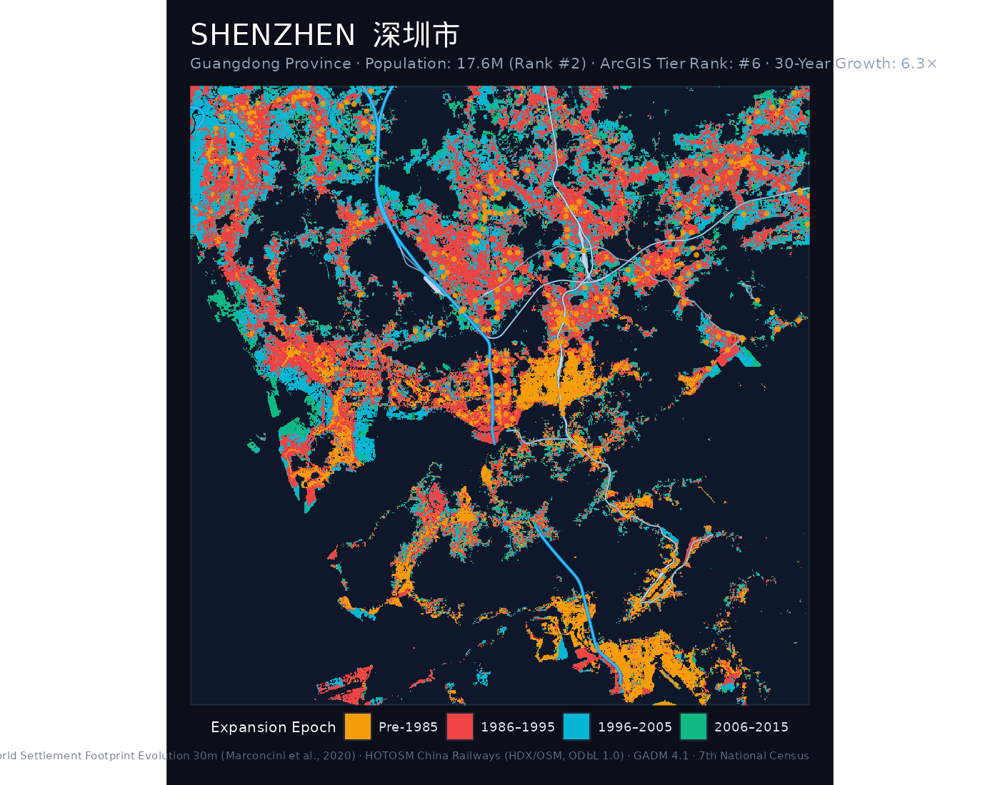
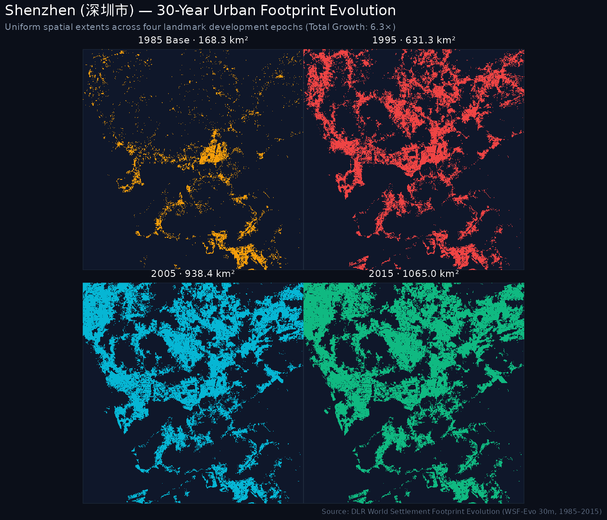
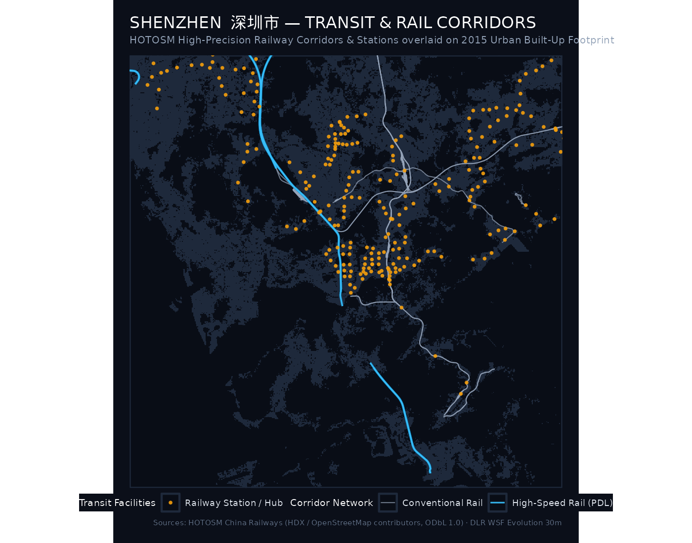
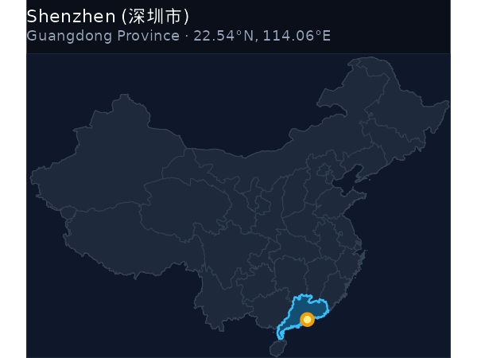
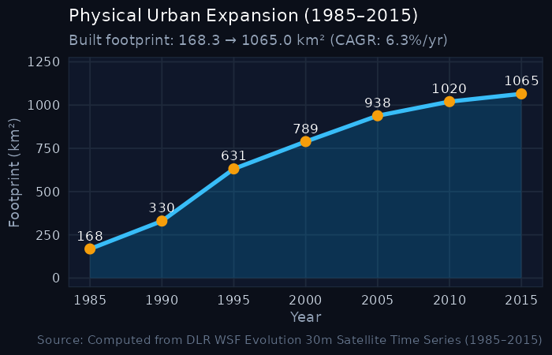

```{=html}
<div class="hero-banner">
  <div style="display: flex; justify-content: space-between; align-items: flex-start; flex-wrap: wrap; gap: 1rem;">
    <div>
      <h1 style="color: #ffffff; margin-bottom: 0.25rem;">Shenzhen <span style="color: #f59e0b; font-weight: normal;">深圳市</span></h1>
      <p style="color: #94a3b8; font-size: 1.1rem; margin: 0;">Shēnzhèn · Guangdong (广东省) · Pearl River & South Coast</p>
      <p style="color: #cbd5e1; font-size: 0.95rem; margin-top: 0.35rem;">
        Population: <strong>17.56 Million</strong> (2020 Census) · 
        Population Rank: <strong>#2</strong> of 47 · 
        ArcGIS Urban Hierarchy Rank: <strong>#6</strong>
      </p>
      <div style="margin-top: 0.75rem; display: flex; flex-wrap: wrap; gap: 0.5rem;">
        <a href="https://en.wikipedia.org/wiki/Shenzhen" target="_blank" rel="noopener" class="resource-btn">📖 Wikipedia (EN)</a>
        <a href="https://zh.wikipedia.org/wiki/%E6%B7%B1%E5%9C%B3%E5%B8%82" target="_blank" rel="noopener" class="resource-btn">🌐 维基百科 (ZH)</a>
        <a href="https://www.wikidata.org/wiki/Q15174" target="_blank" rel="noopener" class="resource-btn">🏷️ Wikidata (Q15174)</a>
        <a href="https://commons.wikimedia.org/wiki/Category%3AMaps%20of%20Shenzhen" target="_blank" rel="noopener" class="resource-btn">🗺️ Commons Maps</a>
        <a href="https://commons.wikimedia.org/w/index.php?search=Shenzhen+map&title=Special:MediaSearch&type=image" target="_blank" rel="noopener" class="resource-btn">🔍 Scanned Maps</a>
      </div>
    </div>
    <div style="text-align: right;">
      <span class="metric-badge badge-gold" style="font-size: 1.1rem; padding: 0.5rem 1rem;">6.33× Growth Multiplier</span>
    </div>
  </div>
</div>
```

## Key Urban Expansion & Hierarchy Indicators

::: {.metric-grid}
::: {.metric-card}
::: {.metric-label}
2020 Population
:::
::: {.metric-val}
17.56 <span style="font-size: 1rem; color: #94a3b8;">M</span>
:::
<div style="font-size: 0.8rem; color: #38bdf8;">Pop Rank #2 of 47</div>
:::

::: {.metric-card}
::: {.metric-label}
ArcGIS City Rank
:::
::: {.metric-val}
#6
:::
<div style="font-size: 0.8rem; color: #94a3b8;">National Big Cities Tier</div>
:::

::: {.metric-card}
::: {.metric-label}
1985 Baseline Area
:::
::: {.metric-val}
168.35 <span style="font-size: 1rem; color: #94a3b8;">km²</span>
:::
:::

::: {.metric-card}
::: {.metric-label}
2015 Urban Footprint
:::
::: {.metric-val}
1064.98 <span style="font-size: 1rem; color: #94a3b8;">km²</span>
:::
<div style="font-size: 0.8rem; color: #10b981;">+896.63 km²</div>
:::

::: {.metric-card}
::: {.metric-label}
Growth Multiple
:::
::: {.metric-val}
6.33×
:::
<div style="font-size: 0.8rem; color: #f59e0b;">Multiplier Rank #5</div>
:::

::: {.metric-card}
::: {.metric-label}
Annual Growth (CAGR)
:::
::: {.metric-val}
6.34%
:::
<div style="font-size: 0.8rem; color: #94a3b8;">1985–2015</div>
:::
:::

---

## 1. The Urban Growth Rings (1985–2015)

The cartographic poster below maps the physical settlement rings of **Shenzhen** across four historical development epochs, overlaid with the high-precision HOTOSM / OpenStreetMap railway transit network:

- <span style="color: #F59E0B; font-weight: bold;">● Pre-1985 Core</span>: Historic urban core and initial post-1949 industrial settlements.
- <span style="color: #EF4444; font-weight: bold;">● 1986–1995 Wave</span>: Early reform, opening up, and Deng Xiaoping's 1992 Southern Tour (*Nanxun*).
- <span style="color: #06B6D4; font-weight: bold;">● 1996–2005 Wave</span>: WTO entry, export industrialization, and new development zones (*Kaifaqu*).
- <span style="color: #10B981; font-weight: bold;">● 2006–2015 Wave</span>: High-speed rail expansion, modern new cities (*Xinqu*), and peri-urban consolidation.
- <span style="color: #38BDF8; font-weight: bold;">━ Railway Corridors</span>: High-precision vector railway network overlaid directly from HOTOSM / OpenStreetMap (high-speed passenger corridors in vibrant cyan, conventional rail lines in silver).

::: {.map-container}

:::

---

## 2. Small Multiples: 4-Epoch Footprint Progression

Uniform-scale physical footprint progression maps tracking built-up settlement expansion over time:

::: {.map-container}

:::

---

## 3. Detailed Rail Network & Transit Corridors

The high-resolution vector map below provides a detailed visualization of the railway network across **Shenzhen**, extracted from OpenStreetMap and the Humanitarian OpenStreetMap Team (HOTOSM). The transit network is superimposed directly over the 2015 built settlement footprint (dark slate silhouette):

::: {.map-container}

:::

### Transit Infrastructure Indicators

::: {.metric-grid}
::: {.metric-card}
::: {.metric-label}
Total Track Segments
:::
::: {.metric-val}
1,754
:::
<div style="font-size: 0.8rem; color: #38bdf8;">HOTOSM Vector Lines</div>
:::

::: {.metric-card}
::: {.metric-label}
High-Speed Rail Segments
:::
::: {.metric-val}
260
:::
<div style="font-size: 0.8rem; color: #38bdf8;">PDL / 250–350 km/h</div>
:::

::: {.metric-card}
::: {.metric-label}
Conventional Rail
:::
::: {.metric-val}
1,494
:::
<div style="font-size: 0.8rem; color: #94a3b8;">Trunk & Connector Lines</div>
:::

::: {.metric-card}
::: {.metric-label}
Stations & Terminals
:::
::: {.metric-val}
274
:::
<div style="font-size: 0.8rem; color: #f59e0b;">Passenger Hubs</div>
:::
:::

- **Major Railway Lines & Corridors**: `京港高速线`, `广深港高速线`, `廣深港高速鐵路 Guangzhou–Shenzhen–Hong Kong High Speed Rail`, `穗深城际线`, `A线 A線 ALine`, `B线 B線 BLine`, `平南线`, `平盐铁路`, `广深线`, `杭深平南货联线`

- **Major Passenger Terminals & Stations**: `坪山高铁站`, `深圳北站`, `1#食堂`, `Station`, `上塘`, `上屋`, `上李朗`, `上村`, `上梅林`, `上水 Sheung Shui`


> **Transit Layer Citation**: Humanitarian OpenStreetMap Team (HOTOSM) & United Nations Office for the Coordination of Humanitarian Affairs (UN OCHA) Centre for Humanitarian Data, *Railways of China Dataset* on HDX ([https://data.humdata.org/dataset/hotosm_chn_railways](https://data.humdata.org/dataset/hotosm_chn_railways)). Feature geometries extracted from OpenStreetMap under the [Open Database License (ODbL 1.0)](https://opendatacommons.org/licenses/odbl/1-0/) by OpenStreetMap contributors. Includes passenger-dedicated high-speed lines, electrified conventional trunk corridors, industrial spurs, and passenger stations.

---

## 4. Geographical Location & Growth Trajectory

:::: {.columns}

::: {.column width="48%"}
### Location in China
::: {.map-container}

:::
:::

::: {.column width="4%"}
:::

::: {.column width="48%"}
### 30-Year Expansion Curve
::: {.map-container}

:::
:::

::::

---

## 5. 5-Year Milestone Chronology

| Milestone Year | Urban Footprint (km²) | Growth vs. 1985 Baseline | Share of 2015 Footprint |
|:---:|:---:|:---:|:---:|
| **1985** | 168.35 km² | 1.00× (Baseline) | 15.8% |
| **1990** | 329.57 km² | 1.96× | 30.9% |
| **1995** | 631.26 km² | 3.75× | 59.3% |
| **2000** | 789.09 km² | 4.69× | 74.1% |
| **2005** | 938.38 km² | 5.57× | 88.1% |
| **2010** | 1020.12 km² | 6.06× | 95.8% |
| **2015** | 1064.98 km² | **6.33×** | 100.0% |

---

## 6. Archival Cartography & Wiki Resources

Direct links to open knowledge, semantic geodata, and scanned map collections for **Shenzhen**:

- 📖 **English Wikipedia**: [Shenzhen](https://en.wikipedia.org/wiki/Shenzhen) — In-depth overview of history, urban development, demographic shifts, and regional governance.
- 🌐 **Chinese Wikipedia (中文维基百科)**: [深圳市](https://zh.wikipedia.org/wiki/%E6%B7%B1%E5%9C%B3%E5%B8%82) — Authoritative municipal boundaries, administrative subdivisions, and local transport infrastructure.
- 🏷️ **Wikidata Knowledge Base**: [Q15174 (Shenzhen)](https://www.wikidata.org/wiki/Q15174) — Semantic knowledge graph entity with geocoordinates, OpenStreetMap tags, and linked administrative entities.
- 🗺️ **Wikimedia Commons Map Repository**: [Category:Maps of Shenzhen](https://commons.wikimedia.org/wiki/Category%3AMaps%20of%20Shenzhen) — Community-curated media repository containing thematic, administrative, and transport maps.
- 🔍 **Scanned Maps & Historical Sheets Search**: [Explore scanned bitmap and topographic maps of Shenzhen on Wikimedia Commons](https://commons.wikimedia.org/w/index.php?search=Shenzhen+map&title=Special:MediaSearch&type=image)

::: {.callout-note title="Selected Scanned Historical Maps on Wikimedia Commons"}
The following scanned historical maps and cartographic surveys covering **Shenzhen** are accessible on Wikimedia Commons:

- [SZ 深圳 Shenzhen 寶安 BaoAn 寶源路 BaoYuan Road 寶安站 BaoAn Metro Station map sign July 2024 R12S 01](https://commons.wikimedia.org/wiki/File%3ASZ%20%E6%B7%B1%E5%9C%B3%20Shenzhen%20%E5%AF%B6%E5%AE%89%20BaoAn%20%E5%AF%B6%E6%BA%90%E8%B7%AF%20BaoYuan%20Road%20%E5%AF%B6%E5%AE%89%E7%AB%99%20BaoAn%20Metro%20Station%20map%20sign%20July%202024%20R12S%2001.jpg) (Wikimedia Commons scanned asset)
- [Shenzhen-location-MAP-in-Guangdong-Province-China](https://commons.wikimedia.org/wiki/File%3AShenzhen-location-MAP-in-Guangdong-Province-China.jpg) (Wikimedia Commons scanned asset)
- [Shenzhen Metro Map Aug 2020](https://commons.wikimedia.org/wiki/File%3AShenzhen%20Metro%20Map%20Aug%202020.png) (Wikimedia Commons scanned asset)

Additional scanned historical maps and topographic sheets can be found via the [Wikimedia Commons Scanned Maps Search](https://commons.wikimedia.org/w/index.php?search=Shenzhen+map&title=Special:MediaSearch&type=image).
:::

---

## 7. Data Sources & Attributions

The quantitative and spatial indicators for **Shenzhen** are synthesized from the following primary sources:

1. **Urban Footprint & Built-Up Surface**: German Aerospace Center (DLR) [World Settlement Footprint Evolution (1985–2015)](https://download.geoservice.dlr.de/WSF_EVO/). 30m resolution multi-decadal satellite detection (*Marconcini et al., 2020, Nature Scientific Data*).
2. **Permanent Resident Population**: National Bureau of Statistics of China (NBS), [Seventh National Population Census (第七次全国人口普查 / 七普 2020)](http://www.stats.gov.cn/). Resident population: **17.56M** (National Rank: **#2** of 47).
3. **National Urban Tier Classification**: Esri / [ArcGIS Online Big Cities Points FeatureServer](https://services1.arcgis.com/4TXrdeWh0RyCqPgB/arcgis/rest/services/big_cities_points/FeatureServer), National City Rank: **#6** of 184 major Chinese cities.
4. **Detailed Transit & Railway Corridors**: Humanitarian OpenStreetMap Team (HOTOSM) & UN OCHA, [Railways of China Dataset](https://data.humdata.org/dataset/hotosm_chn_railways) on HDX. Licensed under the [Open Database License (ODbL 1.0)](https://opendatacommons.org/licenses/odbl/1-0/) by OpenStreetMap contributors. Includes full-precision railway alignments, high-speed rail lines, electrified conventional routes, and station points.
5. **Administrative Boundaries**: [GADM Database of Global Administrative Areas (v4.1)](https://gadm.org/), University of California, Davis.
6. **Archival Cartography & Encyclopedia Resources**: [Wikimedia Foundation](https://www.wikimedia.org/) ([Wikipedia](https://en.wikipedia.org/), [Wikidata](https://www.wikidata.org/), and [Wikimedia Commons](https://commons.wikimedia.org/)).

---

```{=html}
<div style="display: flex; justify-content: space-between; margin-top: 2rem; padding: 1rem; background: #111827; border-radius: 8px;">
  <a href="chengdu.html" style="color: #38bdf8; text-decoration: none;">← Prev: Chengdu (20.94M)</a>
  <a href="../regions/coastal_south.html" style="color: #f59e0b; text-decoration: none;">↑ Pearl River & South Coast</a>
  <a href="xian.html" style="color: #38bdf8; text-decoration: none;">Next: Xi'an (12.95M) →</a>
</div>
```
