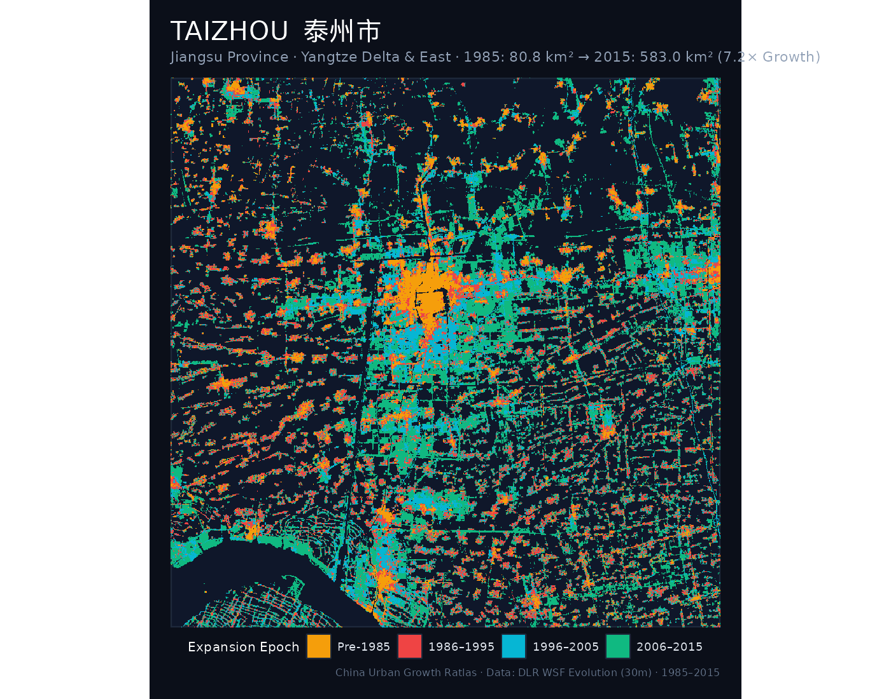
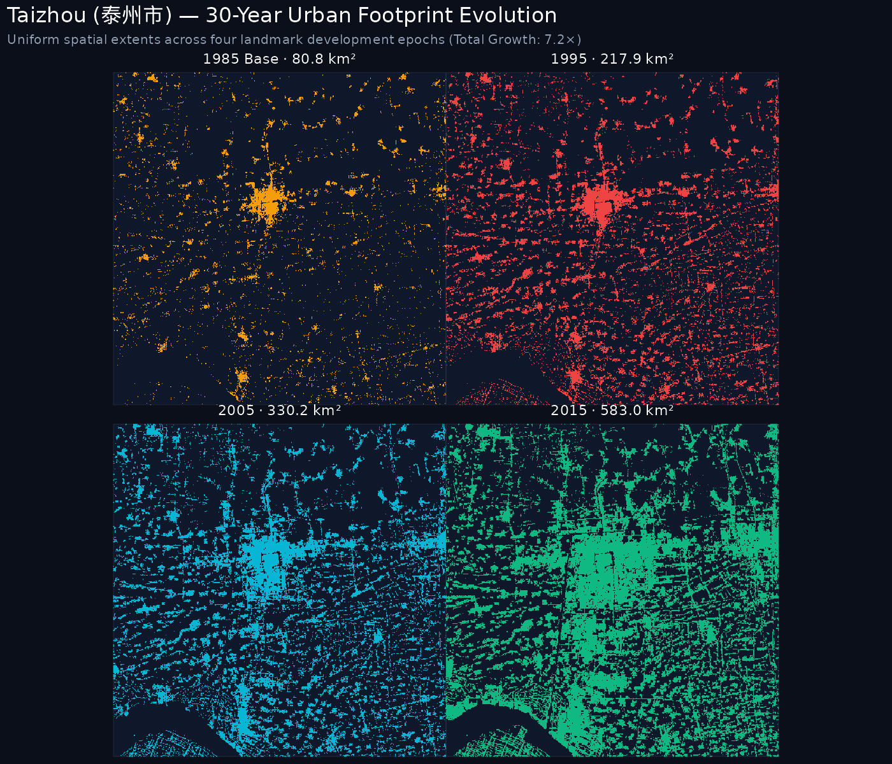
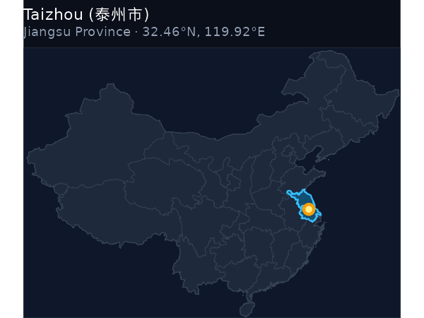
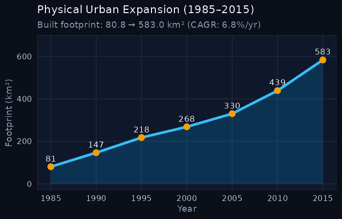

::: {.hero-banner}

  

    <h1 style="color: #ffffff; margin-bottom: 0.25rem;">Taizhou 泰州市</h1>
    
Tàizhōu · Jiangsu Province · National Rank: <strong>#3</strong> of 47

  

  

    7.21× Multiplier
  

:::

## Key Expansion Indicators (1985–2015)

::: {.metric-grid}
::: {.metric-card}
::: {.metric-label}
1985 Baseline Area
:::
::: {.metric-val}
80.81 km²
:::
:::

::: {.metric-card}
::: {.metric-label}
2015 Urban Footprint
:::
::: {.metric-val}
583 km²
:::
:::

::: {.metric-card}
::: {.metric-label}
Net Surface Gain
:::
::: {.metric-val}
+502.19 km²
:::
:::

::: {.metric-card}
::: {.metric-label}
Growth Multiple
:::
::: {.metric-val}
7.21×
:::
:::

::: {.metric-card}
::: {.metric-label}
Annual Growth (CAGR)
:::
::: {.metric-val}
6.81%
:::
:::
:::

---

## 1. The Urban Growth Rings (1985–2015)

The primary cartographic poster below visualizes the physical expansion rings of **Taizhou**, partitioned into four milestone eras:

- ● Pre-1985: Historic core and initial post-1949 development.
- ● 1986–1995: Early reform, opening up, and Deng Xiaoping's southern tour.
- ● 1996–2005: WTO entry, export boom, and new industrial development zones.
- ● 2006–2015: High-speed rail expansion, modern new towns (*xinqu*), and peri-urban consolidation.

::: {.map-container}

:::

---

## 2. Small Multiples: 4-Epoch Footprint Evolution

Comparative uniform-scale footprint maps isolating the cumulative urbanized surface across the four key epochs:

::: {.map-container}

:::

---

## 3. Geographical Context & Growth Trajectory

:::: {.columns}

::: {.column width="48%"}
### National Location
::: {.map-container}

:::
:::

::: {.column width="4%"}
:::

::: {.column width="48%"}
### 30-Year Expansion Curve
::: {.map-container}

:::
:::

::::

---

## 4. 5-Year Milestone Chronology

The table below catalogs the cumulative built-up surface area of Taizhou at 5-year intervals:

| Milestone Year | Urban Footprint (km²) | Growth vs. 1985 Baseline | Share of 2015 Footprint |
|:---:|:---:|:---:|:---:|
| **1985** | 80.81 km² | 1.00× (Baseline) | 13.9% |
| **1990** | 146.78 km² | 1.82× | 25.2% |
| **1995** | 217.91 km² | 2.7× | 37.4% |
| **2000** | 268.48 km² | 3.32× | 46.1% |
| **2005** | 330.23 km² | 4.09× | 56.6% |
| **2010** | 438.55 km² | 5.43× | 75.2% |
| **2015** | 583 km² | **7.21×** | 100.0% |

---

  <a href="chengdu.html" style="color: #38bdf8; text-decoration: none;">← Previous: Chengdu (成都市)</a>
  <a href="../regions/yangtze_delta.html" style="color: #f59e0b; text-decoration: none;">↑ Yangtze Delta & East</a>
  <a href="zhuhai.html" style="color: #38bdf8; text-decoration: none;">Next: Zhuhai (珠海市) →</a>

