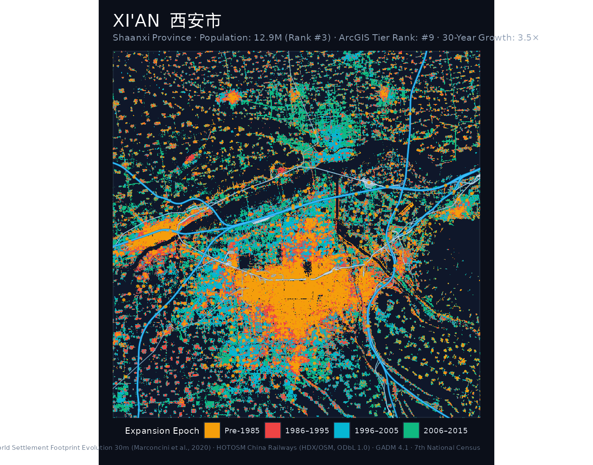
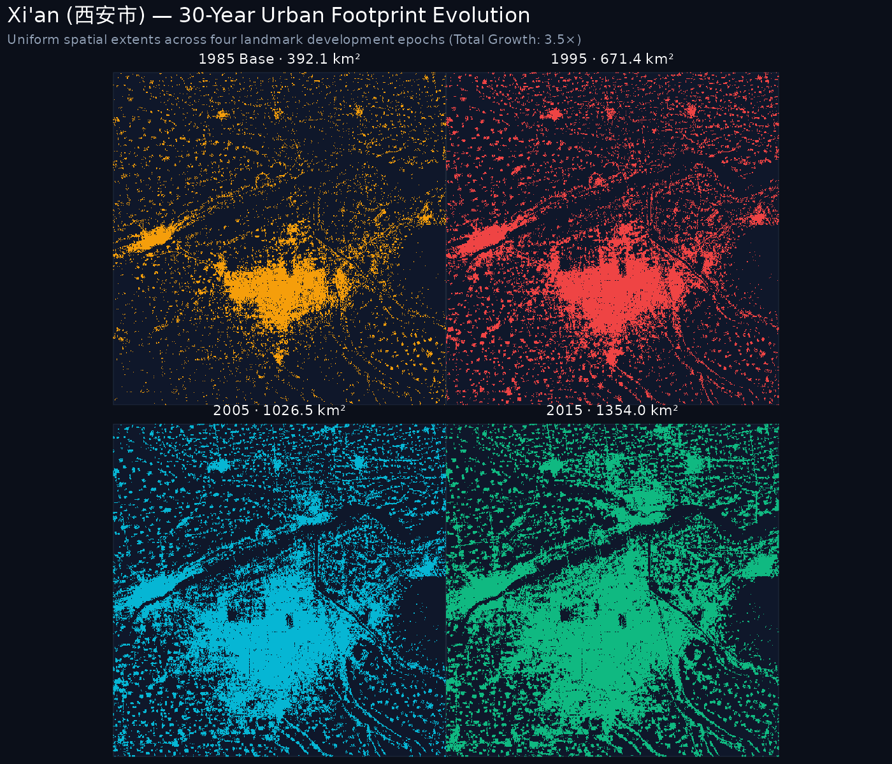
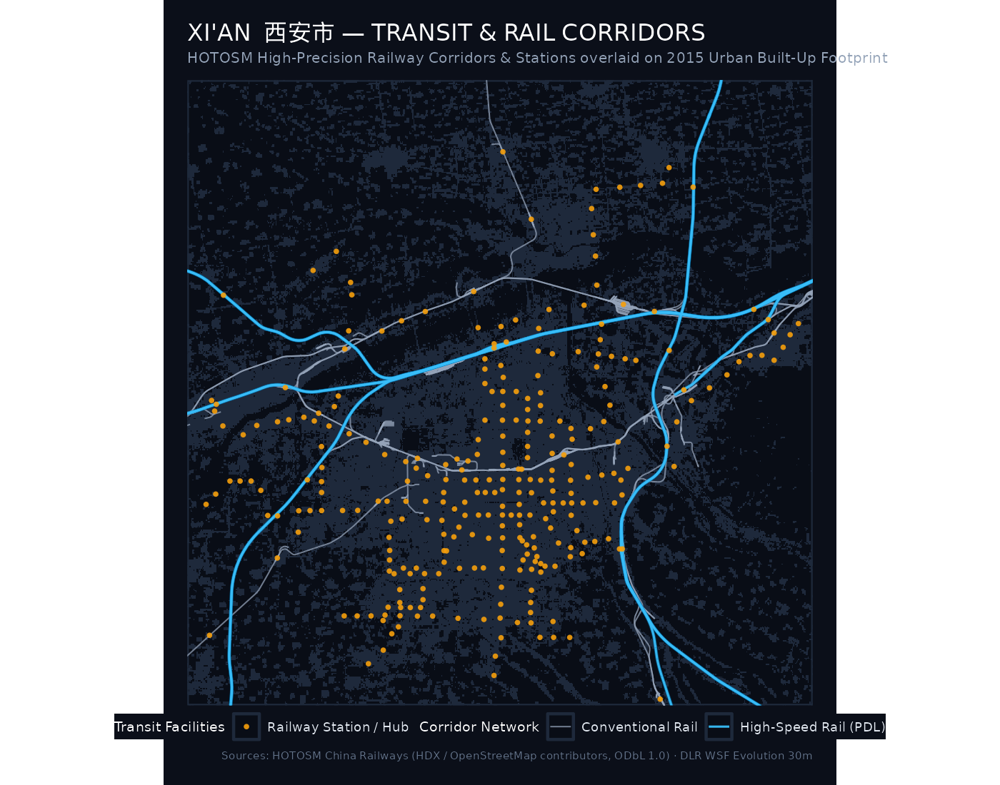
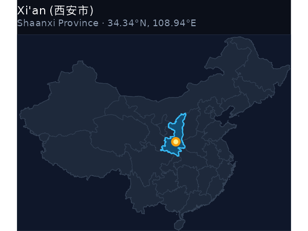
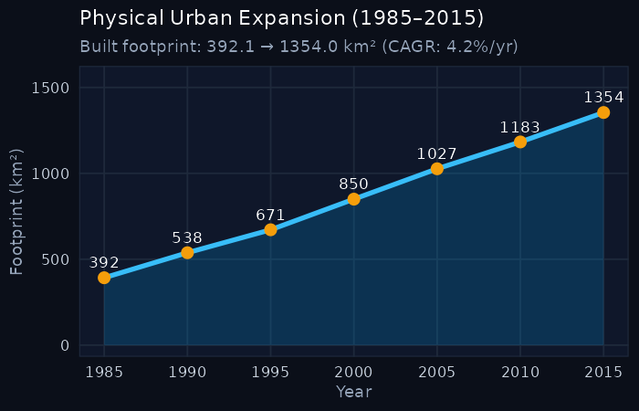

```{=html}
<div class="hero-banner">
  <div style="display: flex; justify-content: space-between; align-items: flex-start; flex-wrap: wrap; gap: 1rem;">
    <div>
      <h1 style="color: #ffffff; margin-bottom: 0.25rem;">Xi'an <span style="color: #f59e0b; font-weight: normal;">西安市</span></h1>
      <p style="color: #94a3b8; font-size: 1.1rem; margin: 0;">Xī'ān · Shaanxi (陕西省) · Western Frontier & Steppe</p>
      <p style="color: #cbd5e1; font-size: 0.95rem; margin-top: 0.35rem;">
        Population: <strong>12.95 Million</strong> (2020 Census) · 
        Population Rank: <strong>#3</strong> of 47 · 
        ArcGIS Urban Hierarchy Rank: <strong>#9</strong>
      </p>
      <div style="margin-top: 0.75rem; display: flex; flex-wrap: wrap; gap: 0.5rem;">
        <a href="https://en.wikipedia.org/wiki/Xi%27an" target="_blank" rel="noopener" class="resource-btn">📖 Wikipedia (EN)</a>
        <a href="https://zh.wikipedia.org/wiki/%E8%A5%BF%E5%AE%89%E5%B8%82" target="_blank" rel="noopener" class="resource-btn">🌐 维基百科 (ZH)</a>
        <a href="https://www.wikidata.org/wiki/Q5826" target="_blank" rel="noopener" class="resource-btn">🏷️ Wikidata (Q5826)</a>
        <a href="https://commons.wikimedia.org/wiki/Category%3AMaps%20of%20Xi%27an" target="_blank" rel="noopener" class="resource-btn">🗺️ Commons Maps</a>
        <a href="https://commons.wikimedia.org/w/index.php?search=Xi%27an+map&title=Special:MediaSearch&type=image" target="_blank" rel="noopener" class="resource-btn">🔍 Scanned Maps</a>
      </div>
    </div>
    <div style="text-align: right;">
      <span class="metric-badge badge-gold" style="font-size: 1.1rem; padding: 0.5rem 1rem;">3.45× Growth Multiplier</span>
    </div>
  </div>
</div>
```

## Key Urban Expansion & Hierarchy Indicators

::: {.metric-grid}
::: {.metric-card}
::: {.metric-label}
2020 Population
:::
::: {.metric-val}
12.95 <span style="font-size: 1rem; color: #94a3b8;">M</span>
:::
<div style="font-size: 0.8rem; color: #38bdf8;">Pop Rank #3 of 47</div>
:::

::: {.metric-card}
::: {.metric-label}
ArcGIS City Rank
:::
::: {.metric-val}
#9
:::
<div style="font-size: 0.8rem; color: #94a3b8;">National Big Cities Tier</div>
:::

::: {.metric-card}
::: {.metric-label}
1985 Baseline Area
:::
::: {.metric-val}
392.14 <span style="font-size: 1rem; color: #94a3b8;">km²</span>
:::
:::

::: {.metric-card}
::: {.metric-label}
2015 Urban Footprint
:::
::: {.metric-val}
1354.03 <span style="font-size: 1rem; color: #94a3b8;">km²</span>
:::
<div style="font-size: 0.8rem; color: #10b981;">+961.89 km²</div>
:::

::: {.metric-card}
::: {.metric-label}
Growth Multiple
:::
::: {.metric-val}
3.45×
:::
<div style="font-size: 0.8rem; color: #f59e0b;">Multiplier Rank #24</div>
:::

::: {.metric-card}
::: {.metric-label}
Annual Growth (CAGR)
:::
::: {.metric-val}
4.22%
:::
<div style="font-size: 0.8rem; color: #94a3b8;">1985–2015</div>
:::
:::

---

## 1. The Urban Growth Rings (1985–2015)

The cartographic poster below maps the physical settlement rings of **Xi'an** across four historical development epochs, overlaid with the high-precision HOTOSM / OpenStreetMap railway transit network:

- <span style="color: #F59E0B; font-weight: bold;">● Pre-1985 Core</span>: Historic urban core and initial post-1949 industrial settlements.
- <span style="color: #EF4444; font-weight: bold;">● 1986–1995 Wave</span>: Early reform, opening up, and Deng Xiaoping's 1992 Southern Tour (*Nanxun*).
- <span style="color: #06B6D4; font-weight: bold;">● 1996–2005 Wave</span>: WTO entry, export industrialization, and new development zones (*Kaifaqu*).
- <span style="color: #10B981; font-weight: bold;">● 2006–2015 Wave</span>: High-speed rail expansion, modern new cities (*Xinqu*), and peri-urban consolidation.
- <span style="color: #38BDF8; font-weight: bold;">━ Railway Corridors</span>: High-precision vector railway network overlaid directly from HOTOSM / OpenStreetMap (high-speed passenger corridors in vibrant cyan, conventional rail lines in silver).

::: {.map-container}

:::

---

## 2. Small Multiples: 4-Epoch Footprint Progression

Uniform-scale physical footprint progression maps tracking built-up settlement expansion over time:

::: {.map-container}

:::

---

## 3. Detailed Rail Network & Transit Corridors

The high-resolution vector map below provides a detailed visualization of the railway network across **Xi'an**, extracted from OpenStreetMap and the Humanitarian OpenStreetMap Team (HOTOSM). The transit network is superimposed directly over the 2015 built settlement footprint (dark slate silhouette):

::: {.map-container}

:::

### Transit Infrastructure Indicators

::: {.metric-grid}
::: {.metric-card}
::: {.metric-label}
Total Track Segments
:::
::: {.metric-val}
2,631
:::
<div style="font-size: 0.8rem; color: #38bdf8;">HOTOSM Vector Lines</div>
:::

::: {.metric-card}
::: {.metric-label}
High-Speed Rail Segments
:::
::: {.metric-val}
203
:::
<div style="font-size: 0.8rem; color: #38bdf8;">PDL / 250–350 km/h</div>
:::

::: {.metric-card}
::: {.metric-label}
Conventional Rail
:::
::: {.metric-val}
2,428
:::
<div style="font-size: 0.8rem; color: #94a3b8;">Trunk & Connector Lines</div>
:::

::: {.metric-card}
::: {.metric-label}
Stations & Terminals
:::
::: {.metric-val}
306
:::
<div style="font-size: 0.8rem; color: #f59e0b;">Passenger Hubs</div>
:::
:::

- **Major Railway Lines & Corridors**: `包西高速线`, `大西高速线`, `徐兰高速线`, `武西高速线`, `西成客专线`, `西渝高速线`, `银西高速线`, `阎机城际铁路`, `三桥西安北动走线`, `动走1线`

- **Major Passenger Terminals & Stations**: `机场西（T1、T2、T3）`, `机场（T5）`, `咸阳西站`, `西安东站`, `西安北站`, `西安南站`, `西安站`, `万寿南路`, `万寿路`, `丈八一路`


> **Transit Layer Citation**: Humanitarian OpenStreetMap Team (HOTOSM) & United Nations Office for the Coordination of Humanitarian Affairs (UN OCHA) Centre for Humanitarian Data, *Railways of China Dataset* on HDX ([https://data.humdata.org/dataset/hotosm_chn_railways](https://data.humdata.org/dataset/hotosm_chn_railways)). Feature geometries extracted from OpenStreetMap under the [Open Database License (ODbL 1.0)](https://opendatacommons.org/licenses/odbl/1-0/) by OpenStreetMap contributors. Includes passenger-dedicated high-speed lines, electrified conventional trunk corridors, industrial spurs, and passenger stations.

---

## 4. Geographical Location & Growth Trajectory

:::: {.columns}

::: {.column width="48%"}
### Location in China
::: {.map-container}

:::
:::

::: {.column width="4%"}
:::

::: {.column width="48%"}
### 30-Year Expansion Curve
::: {.map-container}

:::
:::

::::

---

## 5. 5-Year Milestone Chronology

| Milestone Year | Urban Footprint (km²) | Growth vs. 1985 Baseline | Share of 2015 Footprint |
|:---:|:---:|:---:|:---:|
| **1985** | 392.14 km² | 1.00× (Baseline) | 29.0% |
| **1990** | 537.78 km² | 1.37× | 39.7% |
| **1995** | 671.39 km² | 1.71× | 49.6% |
| **2000** | 849.73 km² | 2.17× | 62.8% |
| **2005** | 1026.52 km² | 2.62× | 75.8% |
| **2010** | 1182.69 km² | 3.02× | 87.3% |
| **2015** | 1354.03 km² | **3.45×** | 100.0% |

---

## 6. Archival Cartography & Wiki Resources

Direct links to open knowledge, semantic geodata, and scanned map collections for **Xi'an**:

- 📖 **English Wikipedia**: [Xi'an](https://en.wikipedia.org/wiki/Xi%27an) — In-depth overview of history, urban development, demographic shifts, and regional governance.
- 🌐 **Chinese Wikipedia (中文维基百科)**: [西安市](https://zh.wikipedia.org/wiki/%E8%A5%BF%E5%AE%89%E5%B8%82) — Authoritative municipal boundaries, administrative subdivisions, and local transport infrastructure.
- 🏷️ **Wikidata Knowledge Base**: [Q5826 (Xi'an)](https://www.wikidata.org/wiki/Q5826) — Semantic knowledge graph entity with geocoordinates, OpenStreetMap tags, and linked administrative entities.
- 🗺️ **Wikimedia Commons Map Repository**: [Category:Maps of Xi'an](https://commons.wikimedia.org/wiki/Category%3AMaps%20of%20Xi%27an) — Community-curated media repository containing thematic, administrative, and transport maps.
- 📜 **Historical Maps Collection**: [Category:Old maps of Xi'an](https://commons.wikimedia.org/wiki/Category%3AOld%20maps%20of%20Xi%27an) — Scanned historical maps, municipal plans, and early surveys.
- 🔍 **Scanned Maps & Historical Sheets Search**: [Explore scanned bitmap and topographic maps of Xi'an on Wikimedia Commons](https://commons.wikimedia.org/w/index.php?search=Xi%27an+map&title=Special:MediaSearch&type=image)

::: {.callout-note title="Selected Scanned Historical Maps on Wikimedia Commons"}
The following scanned historical maps and cartographic surveys covering **Xi'an** are accessible on Wikimedia Commons:

- [Dury Atlas Maps 1 and 2 The World](https://commons.wikimedia.org/wiki/File%3ADury%20Atlas%20Maps%201%20and%202%20The%20World.jpg) (Wikimedia Commons scanned asset)
- [Xian-location-MAP-in-Shaanxi-Province-in-China](https://commons.wikimedia.org/wiki/File%3AXian-location-MAP-in-Shaanxi-Province-in-China.jpg) (Wikimedia Commons scanned asset)
- [Location map of Xi'an, Shaanxi](https://commons.wikimedia.org/wiki/File%3ALocation%20map%20of%20Xi%27an%2C%20Shaanxi.png) (Wikimedia Commons scanned asset)

Additional scanned historical maps and topographic sheets can be found via the [Wikimedia Commons Scanned Maps Search](https://commons.wikimedia.org/w/index.php?search=Xi%27an+map&title=Special:MediaSearch&type=image).
:::

---

## 7. Data Sources & Attributions

The quantitative and spatial indicators for **Xi'an** are synthesized from the following primary sources:

1. **Urban Footprint & Built-Up Surface**: German Aerospace Center (DLR) [World Settlement Footprint Evolution (1985–2015)](https://download.geoservice.dlr.de/WSF_EVO/). 30m resolution multi-decadal satellite detection (*Marconcini et al., 2020, Nature Scientific Data*).
2. **Permanent Resident Population**: National Bureau of Statistics of China (NBS), [Seventh National Population Census (第七次全国人口普查 / 七普 2020)](http://www.stats.gov.cn/). Resident population: **12.95M** (National Rank: **#3** of 47).
3. **National Urban Tier Classification**: Esri / [ArcGIS Online Big Cities Points FeatureServer](https://services1.arcgis.com/4TXrdeWh0RyCqPgB/arcgis/rest/services/big_cities_points/FeatureServer), National City Rank: **#9** of 184 major Chinese cities.
4. **Detailed Transit & Railway Corridors**: Humanitarian OpenStreetMap Team (HOTOSM) & UN OCHA, [Railways of China Dataset](https://data.humdata.org/dataset/hotosm_chn_railways) on HDX. Licensed under the [Open Database License (ODbL 1.0)](https://opendatacommons.org/licenses/odbl/1-0/) by OpenStreetMap contributors. Includes full-precision railway alignments, high-speed rail lines, electrified conventional routes, and station points.
5. **Administrative Boundaries**: [GADM Database of Global Administrative Areas (v4.1)](https://gadm.org/), University of California, Davis.
6. **Archival Cartography & Encyclopedia Resources**: [Wikimedia Foundation](https://www.wikimedia.org/) ([Wikipedia](https://en.wikipedia.org/), [Wikidata](https://www.wikidata.org/), and [Wikimedia Commons](https://commons.wikimedia.org/)).

---

```{=html}
<div style="display: flex; justify-content: space-between; margin-top: 2rem; padding: 1rem; background: #111827; border-radius: 8px;">
  <a href="shenzhen.html" style="color: #38bdf8; text-decoration: none;">← Prev: Shenzhen (17.56M)</a>
  <a href="../regions/western_frontier.html" style="color: #f59e0b; text-decoration: none;">↑ Western Frontier & Steppe</a>
  <a href="zhengzhou.html" style="color: #38bdf8; text-decoration: none;">Next: Zhengzhou (12.6M) →</a>
</div>
```
