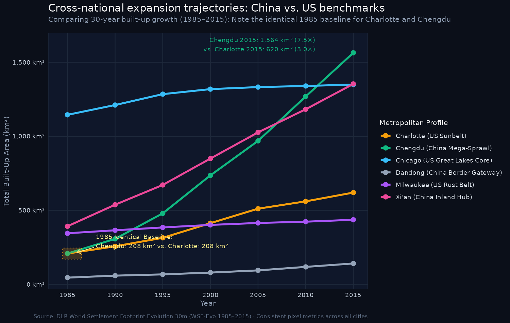
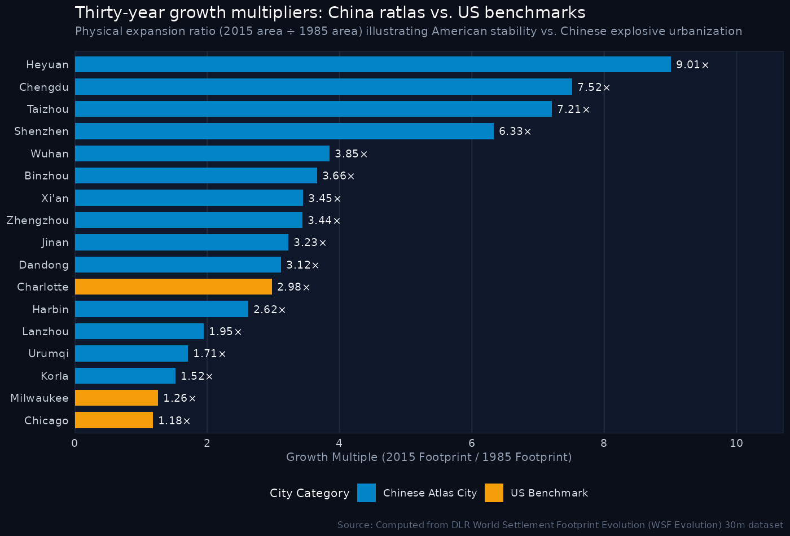
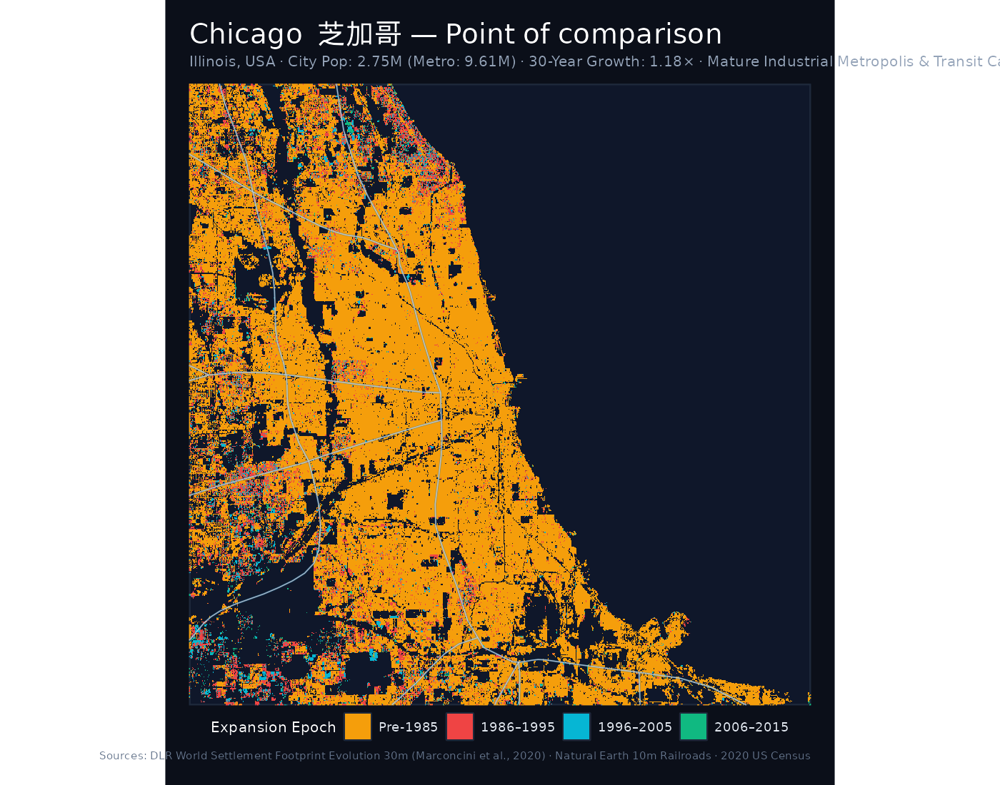
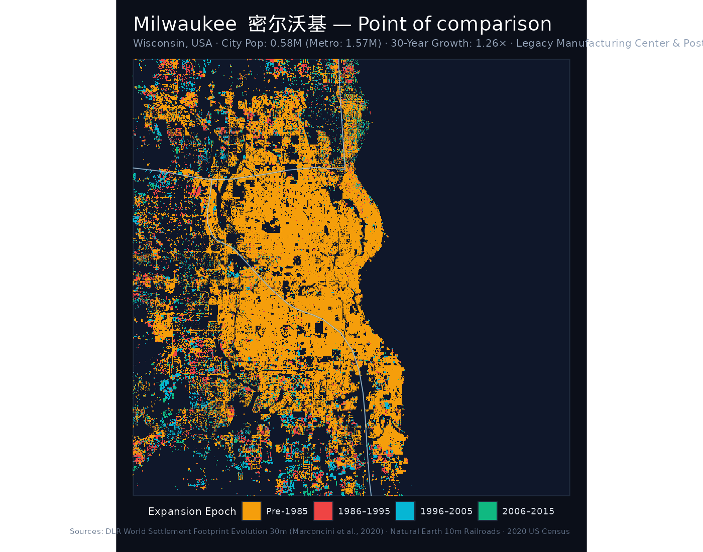
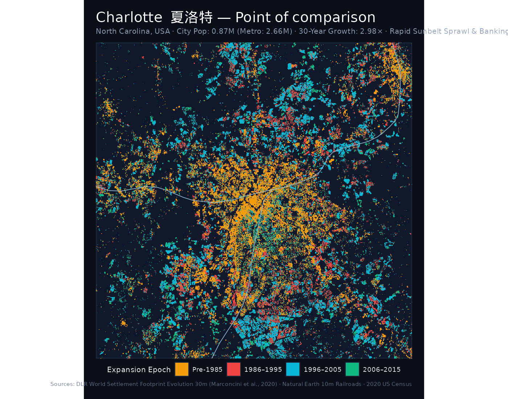

```{=html}
<div class="hero-banner">
  <div style="max-width: 900px;">
    <h1 class="hero-title">Points of Comparison: US Benchmark Metropolises</h1>
    <h2 style="color: #1e3f34; font-size: 1.4rem; margin-top: -0.25rem; margin-bottom: 1rem; font-weight: normal; font-style: normal;">国际城市空间扩展对照研究 · 芝加哥 · 密尔沃基 · 夏洛特</h2>
    <p class="hero-subtitle">
      To contextualize the unprecedented speed, scale, and morphology of China's 30-year urban expansion, this chapter integrates three distinct American metropolitan archetypes—<strong>Chicago</strong>, <strong>Milwaukee</strong>, and <strong>Charlotte</strong>—analyzed using the exact same satellite observation engine: the German Aerospace Center (DLR) World Settlement Footprint Evolution (30m).
    </p>
    <div style="display: flex; gap: 0.75rem; margin-top: 1.5rem; flex-wrap: wrap;">
      <a href="cities/chicago.html" class="resource-btn">Explore Chicago →</a>
      <a href="cities/milwaukee.html" class="resource-btn">Explore Milwaukee →</a>
      <a href="cities/charlotte.html" class="resource-btn">Explore Charlotte →</a>
      <a href="https://drive.google.com/drive/folders/1b-HupghVS7KQn4ZTvGjfOHFFMgPnH2KV?usp=sharing" target="_blank" rel="noopener" class="resource-btn" style="background: #e8ded1; border-color: #943324; font-weight: 600;">Browse AGSL map scans repository (Google Drive) ↗</a>
      <a href="index.html" class="resource-btn">Back to national atlas</a>
    </div>
  </div>
</div>
```

```{=html}
<div class="columns" style="display: flex; gap: 1rem; flex-wrap: wrap; margin-bottom: 2rem;">
  <div style="flex: 1; min-width: 280px; background: #f4efe4; border: 1px solid #d6ccbe; border-radius: 4px; padding: 1.25rem;">
    <div style="display: flex; justify-content: space-between; align-items: center;">
      <h3 style="margin: 0; color: #943324;"><a href="cities/chicago.html" style="color: #943324; text-decoration: none;">Chicago (芝加哥)</a></h3>
      <span class="badge-gold" style="font-size: 0.8rem; padding: 0.2rem 0.5rem; border-radius: 3px;">1.18× Multiplier</span>
    </div>
    <p style="color: #5e524a; font-size: 0.9rem; margin: 0.5rem 0;">Illinois · Great Lakes Core & Rail Hub · Pop: <strong>2.75M</strong> (Metro: 9.61M)</p>
    <p style="color: #221d1a; font-size: 0.85rem; margin-bottom: 0.75rem;">1985 Footprint: <strong>1,145.2 km²</strong> (vast initial baseline) → 2015: <strong>1,349.6 km²</strong> (+204.4 km², 0.55% CAGR). Contrasts with explosive Chinese mega-expansion.</p>
    <a href="cities/chicago.html" style="color: #943324; font-weight: 600; font-size: 0.85rem;">Explore Chicago Map Suite →</a>
  </div>
  <div style="flex: 1; min-width: 280px; background: #f4efe4; border: 1px solid #d6ccbe; border-radius: 4px; padding: 1.25rem;">
    <div style="display: flex; justify-content: space-between; align-items: center;">
      <h3 style="margin: 0; color: #943324;"><a href="cities/milwaukee.html" style="color: #943324; text-decoration: none;">Milwaukee (密尔沃基)</a></h3>
      <span class="badge-gold" style="font-size: 0.8rem; padding: 0.2rem 0.5rem; border-radius: 3px;">1.26× Multiplier</span>
    </div>
    <p style="color: #5e524a; font-size: 0.9rem; margin: 0.5rem 0;">Wisconsin · Great Lakes Rust Belt · Pop: <strong>0.58M</strong> (Metro: 1.57M)</p>
    <p style="color: #221d1a; font-size: 0.85rem; margin-bottom: 0.75rem;">1985 Footprint: <strong>344.9 km²</strong> → 2015: <strong>436.1 km²</strong> (+91.2 km², 0.78% CAGR). Post-industrial stability directly paralleling Northeast China's 43°N belt.</p>
    <a href="cities/milwaukee.html" style="color: #943324; font-weight: 600; font-size: 0.85rem;">Explore Milwaukee Map Suite →</a>
  </div>
  <div style="flex: 1; min-width: 280px; background: #f4efe4; border: 1px solid #d6ccbe; border-radius: 4px; padding: 1.25rem;">
    <div style="display: flex; justify-content: space-between; align-items: center;">
      <h3 style="margin: 0; color: #943324;"><a href="cities/charlotte.html" style="color: #943324; text-decoration: none;">Charlotte (夏洛特)</a></h3>
      <span class="badge-gold" style="font-size: 0.8rem; padding: 0.2rem 0.5rem; border-radius: 3px;">2.98× Multiplier</span>
    </div>
    <p style="color: #5e524a; font-size: 0.9rem; margin: 0.5rem 0;">North Carolina · Sunbelt Financial Hub · Pop: <strong>0.87M</strong> (Metro: 2.66M)</p>
    <p style="color: #221d1a; font-size: 0.85rem; margin-bottom: 0.75rem;">1985 Footprint: <strong>208.0 km²</strong> (identical to Chengdu: 208.1 km²) → 2015: <strong>619.8 km²</strong> (+411.8 km²). Charlotte tripled, but Chengdu surged 7.5× to 1,564 km²!</p>
    <a href="cities/charlotte.html" style="color: #943324; font-weight: 600; font-size: 0.85rem;">Explore Charlotte Map Suite →</a>
  </div>
</div>
```

::: {.callout-note appearance="simple" icon=true}
## Methodological rigor: Uniform global satellite detection
Unlike census boundaries or municipal administrative definitions—which differ radically between nations—the **DLR World Settlement Footprint Evolution (WSF Evolution)** operates on a unified, objective 30-meter physical detection algorithm globally. Every pixel reflects actual imperviously paved and built physical structures detected through joint optical Landsat and radar satellite observations from 1985 to 2015.
:::

## 1. Cross-national expansion trajectories

The plot below charts the 30-year cumulative built-up area trajectories for Charlotte, Chicago, and Milwaukee plotted directly against key Chinese metropolises (Chengdu, Xi'an, and Dandong):

::: {.map-container}

:::

---

## 2. The Charlotte vs. Chengdu paradox

Perhaps the single most illuminating comparison in this entire project is the trajectory of **Charlotte, North Carolina** versus **Chengdu, Sichuan**:

- In **1985**, Charlotte's built settlement footprint was **207.98 km²**.
- In **1985**, Chengdu's built settlement footprint was **208.06 km²**.

The two cities started from a virtually identical physical baseline, separated by less than 0.1 square kilometer. Both functioned as key regional hubs—Chengdu as the historical agricultural and cultural capital of the Sichuan Basin, Charlotte as an emerging Piedmont banking center.

Over the next three decades:
- **Charlotte** became one of the fastest-growing metropolitan economies in the United States, expanding via low-density automobile suburbanization along the I-485 beltway, tripling its built area to **619.79 km²** (+411.81 km², **2.98× multiplier**, **3.71% CAGR**).
- **Chengdu** underwent a monumental densification and concentric multi-ring expansion, constructing five ring roads, the Tianfu New Area, and a 12-line metro system, exploding to **1,564.15 km²** (+1,356.09 km², **7.52× multiplier**, **6.96% CAGR**).

Chengdu added **over three times more new built land** than Charlotte over the identical period, demonstrating how China's transit-oriented, high-density metropolitan expansion operated on an order of magnitude unreachable even by the most aggressive American Sunbelt suburban boomtowns.

---

## 3. Growth multiplier comparison: American stability vs. Chinese speed

How does the relative expansion multiple (2015 footprint ÷ 1985 footprint) compare across national contexts?

::: {.map-container}

:::

- **American Growth Multipliers**: Clustered narrowly between **1.18×** (Chicago) and **2.98×** (Charlotte). Even rapidly sprawling American cities rarely tripled their built footprint over 1985–2015.
- **Chinese Growth Multipliers**: Distributed across a vastly higher range, from **1.52×** (Korla) up to **9.01×** (Heyuan), with a national median of **3.66×**. Provincial capitals and SEZs routinely multiplied by 4× to 8×.

---

## 4. Master comparative matrix (US benchmarks & Chinese peers)

The table below contrasts the quantitative spatial indicators of Chicago, Milwaukee, and Charlotte alongside selected Chinese cities spanning diverse regions and growth tiers:

| City | Chinese | Country & Jurisdiction | Growth Archetype | 2020 Population | 1985 Area | 2015 Area | Net Gain | Multiplier | CAGR | Comparative Peer |
|:---|:---|:---|:---|:---:|:---:|:---:|:---:|:---:|:---:|:---|
| [Chicago](cities/chicago.html) | 芝加哥 | United States (Illinois) | Mature Industrial Hub | **2.75M** (Metro: 9.61M) | 1,145.18 km² | 1,349.62 km² | +204.44 km² | **1.18×** | 0.55% | Xi'an / Wuhan |
| [Milwaukee](cities/milwaukee.html) | 密尔沃基 | United States (Wisconsin) | Great Lakes Rust Belt | **0.58M** (Metro: 1.57M) | 344.94 km² | 436.09 km² | +91.15 km² | **1.26×** | 0.78% | Northeast Rust Belt (Fuxin / Dandong) |
| [Charlotte](cities/charlotte.html) | 夏洛特 | United States (North Carolina) | Sunbelt Banking Boomtown | **0.87M** (Metro: 2.66M) | 207.98 km² | 619.79 km² | +411.81 km² | **2.98×** | 3.71% | Chengdu (started identical at ~208 km²) |
| [Chengdu](cities/chengdu.html) | 成都市 | China (Sichuan) | Inland Megacity Hub | **20.94M** | 208.06 km² | 1,564.15 km² | +1,356.09 km² | **7.52×** | 6.96% | Charlotte (US Sunbelt Sprawl) |
| [Shenzhen](cities/shenzhen.html) | 深圳市 | China (Guangdong) | Special Economic Zone | **17.56M** | 168.35 km² | 1,064.98 km² | +896.63 km² | **6.33×** | 6.34% | Silicon Valley / Global Tech Capital |
| [Xi'an](cities/xian.html) | 西安市 | China (Shaanxi) | Inland Gateway & Tech Hub | **12.95M** | 392.14 km² | 1,354.03 km² | +961.89 km² | **3.45×** | 4.22% | Chicago / Milwaukee |
| [Wuhan](cities/wuhan.html) | 武汉市 | China (Hubei) | Riverine Megacity & Rail Hub | **12.33M** | 279.63 km² | 1,077.90 km² | +798.27 km² | **3.85×** | 4.60% | Chicago (Midwest Rail Crossroad) |
| [Harbin](cities/harbin.html) | 哈尔滨市 | China (Heilongjiang) | Northern Heavy Industrial Base | **10.01M** | 267.74 km² | 701.48 km² | +433.74 km² | **2.62×** | 3.26% | Milwaukee (Cold Climate Heavy Industry) |
| [Dandong](cities/dandong.html) | 丹东市 | China (Liaoning) | Border Gateway & Port | **2.19M** | 45.20 km² | 140.92 km² | +95.72 km² | **3.12×** | 3.86% | Milwaukee / Great Lakes Ports |
| [Heyuan](cities/heyuan.html) | 河源市 | China (Guangdong) | Pearl River Growth Vanguard | **2.84M** | 15.15 km² | 136.49 km² | +121.34 km² | **9.01×** | 7.60% | Rapid Developing SEZ Hinterland |


---

## 5. Summary of the three US benchmark archetypes

:::: {.columns}

::: {.column width="32%"}
### Chicago, Illinois
::: {.map-container}

:::
- **1985 Area**: 1,145.18 km²
- **2015 Area**: 1,349.62 km² (+204.44 km²)
- **Growth Multiple**: **1.18×** (0.55% CAGR)
- **Role**: Established continental colossus. Highlights that Western megacities had already achieved vast physical footprints prior to 1985.
[Full Chicago Page →](cities/chicago.html)
:::

::: {.column width="32%"}
### Milwaukee, Wisconsin
::: {.map-container}

:::
- **1985 Area**: 344.94 km²
- **2015 Area**: 436.09 km² (+91.15 km²)
- **Growth Multiple**: **1.26×** (0.78% CAGR)
- **Role**: Great Lakes industrial peer to Northeast China. Shows spatial stability during post-industrial economic restructuring.
[Full Milwaukee Page →](cities/milwaukee.html)
:::

::: {.column width="32%"}
### Charlotte, North Carolina
::: {.map-container}

:::
- **1985 Area**: 207.98 km²
- **2015 Area**: 619.79 km² (+411.81 km²)
- **Growth Multiple**: **2.98×** (3.71% CAGR)
- **Role**: Sunbelt car-centric sprawl star. Direct counterpart to Chengdu's identical 1985 starting footprint.
[Full Charlotte Page →](cities/charlotte.html)
:::

::::

---

::: {.caption-box}
**Data Sources**: German Aerospace Center (DLR) World Settlement Footprint Evolution 30m (Marconcini et al., 2020) · U.S. Census Bureau (2020 Decennial Census) · 7th National Population Census of China (2020) · Natural Earth 10m Railroads · American Geographical Society Library (AGSL) · HOTOSM Railways of China.
:::
