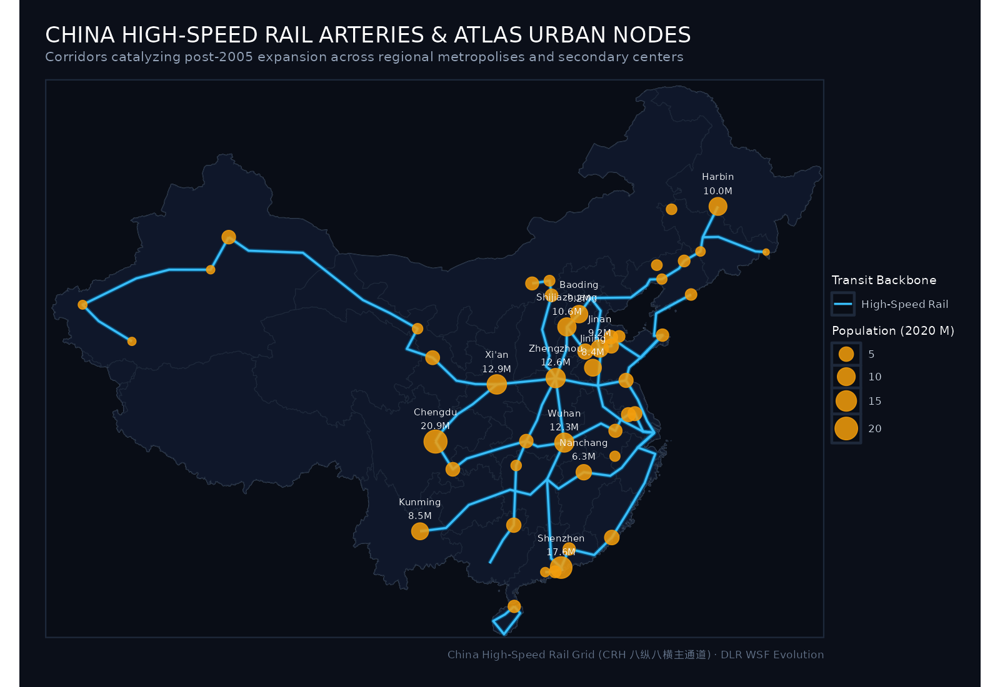
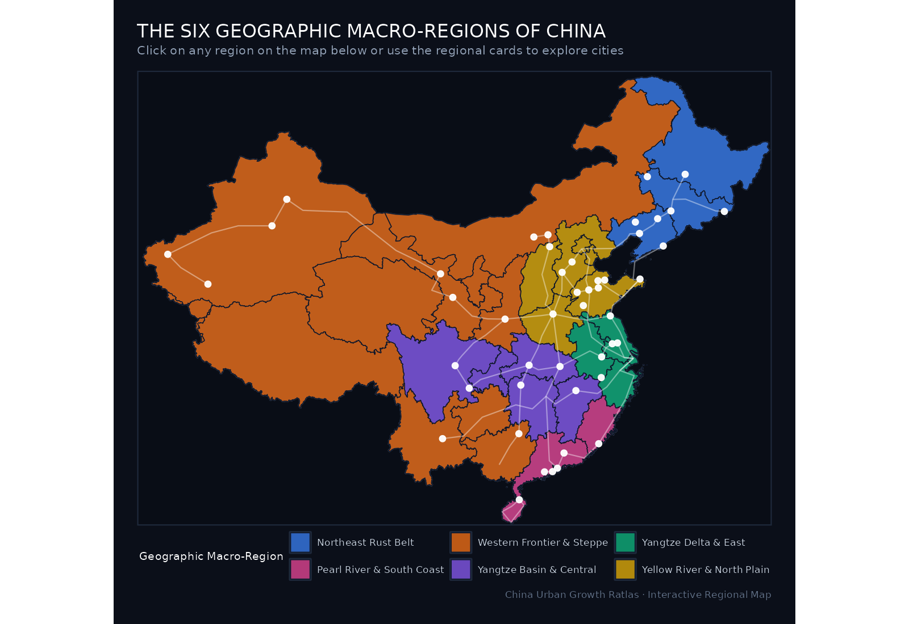

```{=html}
<div class="hero-banner">
  <div style="max-width: 900px;">
    <h1 class="hero-title">China Urban Growth Ratlas</h1>
    <h2 style="color: #f59e0b; font-size: 1.5rem; margin-top: -0.25rem; margin-bottom: 1rem;">中国城市空间扩展图集 · 1985–2015</h2>
    <p class="hero-subtitle">
      Between 1985 and 2015, the People's Republic of China underwent the largest physical urbanization process in human history. 
      This ratlas maps the spatial morphology, expansion rings, High-Speed Rail corridors, and quantitative growth trajectories across <strong>47 diverse Chinese cities</strong> ranked by population.
    </p>
    <div style="display: flex; gap: 1rem; margin-top: 1.5rem; flex-wrap: wrap;">
      <a href="cities.html" class="btn btn-primary" style="background: #0284c7; border: none; padding: 0.6rem 1.25rem; font-weight: 600;">Browse All 47 Cities →</a>
      <a href="methodology.html" class="btn btn-secondary" style="background: #1e293b; color: #cbd5e1; border: 1px solid #334155; padding: 0.6rem 1.25rem;">Methodology & Data</a>
    </div>
  </div>
</div>
```

::: {.callout-note appearance="simple" icon=true}
## Scope & Sample Selection: Excluding Tier-1 Superstar Megacities
The 47 cities in this atlas were deliberately selected to **exclude China's absolute largest tier-1 megacities** (specifically Beijing, Shanghai, Guangzhou, Chongqing, and Tianjin).

By centering on dynamic provincial capitals (e.g., Chengdu, Wuhan, Xi'an, Zhengzhou), specialized manufacturing nodes (e.g., Shenzhen, Zhuhai, Taizhou, Zibo), ancient Silk Road oases (e.g., Kashgar, Hotan, Wuwei), and strategic border gateways (e.g., Dandong, Hunchun), this ratlas examines how physical urbanization and infrastructure modernization transformed the full depth of China's urban hierarchy beyond the global superstar metropolises.
:::

## Key Findings & National Overview

::: {.metric-grid}
::: {.metric-card}
::: {.metric-label}
Total Cities Analyzed
:::
::: {.metric-val}
47
:::
<div style="font-size: 0.8rem; color: #38bdf8;">Ranked by Population</div>
:::

::: {.metric-card}
::: {.metric-label}
Largest City (2020)
:::
::: {.metric-val}
20.9 <span style="font-size: 1rem;">M</span>
:::
<div style="font-size: 0.8rem; color: #f59e0b;">Chengdu (成都市)</div>
:::

::: {.metric-card}
::: {.metric-label}
Peak Growth Multiple
:::
::: {.metric-val}
9.0×
:::
<div style="font-size: 0.8rem; color: #f59e0b;">Heyuan (河源市)</div>
:::

::: {.metric-card}
::: {.metric-label}
Peak Area Expansion
:::
::: {.metric-val}
+1,356 <span style="font-size: 1rem;">km²</span>
:::
<div style="font-size: 0.8rem; color: #10b981;">Chengdu (成都市)</div>
:::

::: {.metric-card}
::: {.metric-label}
Transit Integration
:::
::: {.metric-val}
CRH
:::
<div style="font-size: 0.8rem; color: #38bdf8;">High-Speed Rail Grid</div>
:::
:::

---

## National Urban Expansion & High-Speed Rail Map

The map below displays all 47 cities in the ratlas across China, sized by **2020 Census Population**, colored by **30-year growth multiplier**, and overlaid with China's **High-Speed Rail network (CRH 高铁)**:

::: {.map-container}

:::

---

## High-Speed Rail Network & Urban Hierarchy

China's High-Speed Rail network physically stitched together regional capitals and secondary nodes, accelerating post-2005 outward expansion:

::: {.map-container}

:::

---

## 30-Year Growth Multiplier Rankings

Which cities experienced the highest relative spatial expansion between 1985 and 2015?

::: {.map-container}

:::

---

## Interactive Regional Explorations

Click any region on the interactive map below to jump directly to its dedicated regional chapter, or explore via the region cards below:

```{=html}
<div style="position: relative; width: 100%; max-width: 1100px; margin: 1.5rem auto; border-radius: 10px; overflow: hidden; border: 1px solid #1f2937; box-shadow: 0 10px 30px rgba(0,0,0,0.7);">
  <!-- Base Regional Map Graphic -->
  

  <!-- Interactive SVG Clickable Overlay with Glowing Regions -->
  <svg viewBox="0 0 1600 1100" style="position: absolute; top: 0; left: 0; width: 100%; height: 100%; pointer-events: auto;">
    <style>
      .reg-link { cursor: pointer; transition: all 0.25s ease; }
      .reg-poly { fill: transparent; stroke: transparent; stroke-width: 3; transition: all 0.25s ease; }
      .reg-link:hover .reg-poly { fill: rgba(56, 189, 248, 0.28); stroke: #38bdf8; filter: drop-shadow(0 0 12px rgba(56, 189, 248, 0.9)); }
      .reg-link text { fill: #f8fafc; font-size: 26px; font-weight: bold; text-anchor: middle; pointer-events: none; opacity: 0.9; text-shadow: 0 2px 6px rgba(0,0,0,0.9); }
    </style>

    <!-- Northeast Rust Belt -->
    <a href="regions/northeast.html" class="reg-link" title="Northeast Rust Belt (8 Cities)">
      <polygon class="reg-poly" points="1160,80 1560,80 1560,420 1200,450 1160,350" />
      <text x="1350" y="240">Northeast Rust Belt →</text>
    </a>

    <!-- Yellow River & North Plain -->
    <a href="regions/northern_plains.html" class="reg-link" title="Yellow River & North Plain (11 Cities)">
      <polygon class="reg-poly" points="960,380 1260,380 1260,600 960,600" />
      <text x="1110" y="490">North Plain & Bohai →</text>
    </a>

    <!-- Yangtze Delta & East -->
    <a href="regions/yangtze_delta.html" class="reg-link" title="Yangtze Delta & East (5 Cities)">
      <polygon class="reg-poly" points="1090,560 1260,560 1260,730 1090,730" />
      <text x="1180" y="650">Yangtze Delta →</text>
    </a>

    <!-- Yangtze Basin & Central -->
    <a href="regions/yangtze_basin.html" class="reg-link" title="Yangtze Basin & Central (6 Cities)">
      <polygon class="reg-poly" points="760,590 1100,590 1100,780 760,780" />
      <text x="930" y="690">Yangtze Basin & Central →</text>
    </a>

    <!-- Pearl River & South Coast -->
    <a href="regions/coastal_south.html" class="reg-link" title="Pearl River & South Coast (6 Cities)">
      <polygon class="reg-poly" points="890,780 1230,780 1230,1020 890,1020" />
      <text x="1060" y="900">Pearl River & South Coast →</text>
    </a>

    <!-- Western Frontier & Steppe -->
    <a href="regions/western_frontier.html" class="reg-link" title="Western Frontier & Steppe (11 Cities)">
      <polygon class="reg-poly" points="50,180 960,180 820,950 50,700" />
      <text x="480" y="460">Western Frontier & Steppe →</text>
    </a>
  </svg>

  <!-- Standard HTML5 Image Map Fallback -->
  <map name="chinaregions">
    <area shape="poly" coords="1160,80,1560,80,1560,420,1200,450,1160,350" href="regions/northeast.html" alt="Northeast Rust Belt">
    <area shape="poly" coords="960,380,1260,380,1260,600,960,600" href="regions/northern_plains.html" alt="Yellow River & North Plain">
    <area shape="poly" coords="1090,560,1260,560,1260,730,1090,730" href="regions/yangtze_delta.html" alt="Yangtze Delta & East">
    <area shape="poly" coords="760,590,1100,590,1100,780,760,780" href="regions/yangtze_basin.html" alt="Yangtze Basin & Central">
    <area shape="poly" coords="890,780,1230,780,1230,1020,890,1020" href="regions/coastal_south.html" alt="Pearl River & South Coast">
    <area shape="poly" coords="50,180,960,180,820,950,50,700" href="regions/western_frontier.html" alt="Western Frontier & Steppe">
  </map>
</div>
```

::: {.columns}

::: {.column width="32%"}
::: {.region-card}
### [Pearl River & South Coast](regions/coastal_south.html)
Special Economic Zones, export engines, and coastal reclaimers.
- **Cities**: Shenzhen, Xiamen, Haikou, Heyuan, Zhuhai, Taishan
[Explore Region →](regions/coastal_south.html)
:::
:::

::: {.column width="32%"}
::: {.region-card}
### [Yangtze Basin & Central](regions/yangtze_basin.html)
Inland megacities and riverine industrial corridors.
- **Cities**: Chengdu, Wuhan, Nanchang, Luzhou, Yichang, Zhangjiajie
[Explore Region →](regions/yangtze_basin.html)
:::
:::

::: {.column width="32%"}
::: {.region-card}
### [Yangtze Delta & East](regions/yangtze_delta.html)
Interconnected manufacturing clusters and canal towns.
- **Cities**: Lianyungang, Yangzhou, Taizhou, Wuhu, Huangshan
[Explore Region →](regions/yangtze_delta.html)
:::
:::

:::

::: {.columns}

::: {.column width="32%"}
::: {.region-card}
### [Yellow River & North Plain](regions/northern_plains.html)
Heavy industrial centers across the agricultural heartland.
- **Cities**: Zhengzhou, Shijiazhuang, Baoding, Jinan, Jining, Liaocheng...
[Explore Region →](regions/northern_plains.html)
:::
:::

::: {.column width="32%"}
::: {.region-card}
### [Northeast Rust Belt](regions/northeast.html)
Early industrial powerhouses and international border gateways.
- **Cities**: Harbin, Tieling, Dandong, Fuxin, Baicheng, Panjin...
[Explore Region →](regions/northeast.html)
:::
:::

::: {.column width="32%"}
::: {.region-card}
### [Western Frontier & Steppe](regions/western_frontier.html)
Silk Road oasis towns, highland capitals, and desert gateways.
- **Cities**: Xi'an, Kunming, Guilin, Lanzhou, Urumqi, Hohhot, Kashgar...
[Explore Region →](regions/western_frontier.html)
:::
:::

:::

---

## Complete 47-City Master Index (Ranked by Population)

| Pop Rank | City | Chinese | Province | Region | Population (2020) | 1985 Area | 2015 Area | Net Gain | Multiplier | CAGR |
|:---:|:---|:---|:---|:---|:---:|:---:|:---:|:---:|:---:|:---:|
| #1 | [Chengdu](cities/chengdu.html) | 成都市 | Sichuan | Yangtze Basin & Central | **20.94M** | 208.06 km² | 1564.15 km² | +1356.09 km² | **7.52×** | 6.96% |
| #2 | [Shenzhen](cities/shenzhen.html) | 深圳市 | Guangdong | Pearl River & South Coast | **17.56M** | 168.35 km² | 1064.98 km² | +896.63 km² | **6.33×** | 6.34% |
| #3 | [Xi'an](cities/xian.html) | 西安市 | Shaanxi | Western Frontier & Steppe | **12.95M** | 392.14 km² | 1354.03 km² | +961.89 km² | **3.45×** | 4.22% |
| #4 | [Zhengzhou](cities/zhengzhou.html) | 郑州市 | Henan | Yellow River & North Plain | **12.6M** | 315.56 km² | 1084.55 km² | +768.99 km² | **3.44×** | 4.2% |
| #5 | [Wuhan](cities/wuhan.html) | 武汉市 | Hubei | Yangtze Basin & Central | **12.33M** | 279.63 km² | 1077.9 km² | +798.27 km² | **3.85×** | 4.6% |
| #6 | [Shijiazhuang](cities/shijiazhuang.html) | 石家庄市 | Hebei | Yellow River & North Plain | **10.64M** | 307.22 km² | 811.55 km² | +504.33 km² | **2.64×** | 3.29% |
| #7 | [Harbin](cities/harbin.html) | 哈尔滨市 | Heilongjiang | Northeast Rust Belt | **10.01M** | 267.74 km² | 701.48 km² | +433.74 km² | **2.62×** | 3.26% |
| #8 | [Baoding](cities/baoding.html) | 保定市 | Hebei | Yellow River & North Plain | **9.24M** | 132.36 km² | 526.12 km² | +393.76 km² | **3.97×** | 4.71% |
| #9 | [Jinan](cities/jinan.html) | 济南市 | Shandong | Yellow River & North Plain | **9.2M** | 200.11 km² | 647.13 km² | +447.02 km² | **3.23×** | 3.99% |
| #10 | [Kunming](cities/kunming.html) | 昆明市 | Yunnan | South & Southwest | **8.46M** | 153.06 km² | 624.84 km² | +471.78 km² | **4.08×** | 4.8% |
| #11 | [Jining](cities/jining.html) | 济宁市 | Shandong | Yellow River & North Plain | **8.36M** | 77.41 km² | 391.12 km² | +313.71 km² | **5.05×** | 5.55% |
| #12 | [Nanchang](cities/nanchang.html) | 南昌市 | Jiangxi | Yangtze Basin & Central | **6.26M** | 178.79 km² | 608.57 km² | +429.78 km² | **3.4×** | 4.17% |
| #13 | [Liaocheng](cities/liaocheng.html) | 聊城市 | Shandong | Yellow River & North Plain | **5.95M** | 86.36 km² | 279.69 km² | +193.33 km² | **3.24×** | 3.99% |
| #14 | [Xiamen](cities/xiamen.html) | 厦门市 | Fujian | Pearl River & South Coast | **5.16M** | 128.93 km² | 473.04 km² | +344.11 km² | **3.67×** | 4.43% |
| #15 | [Guilin](cities/guilin.html) | 桂林市 | Guangxi | South & Southwest | **4.93M** | 76.14 km² | 254.1 km² | +177.96 km² | **3.34×** | 4.1% |
| #16 | [Zibo](cities/zibo.html) | 淄博市 | Shandong | Yellow River & North Plain | **4.7M** | 180.8 km² | 660.67 km² | +479.87 km² | **3.65×** | 4.41% |
| #17 | [Lianyungang](cities/lianyungang.html) | 连云港市 | Jiangsu | Yangtze Delta & East | **4.6M** | 135.75 km² | 369.04 km² | +233.29 km² | **2.72×** | 3.39% |
| #18 | [Yangzhou](cities/yangzhou.html) | 扬州市 | Jiangsu | Yangtze Delta & East | **4.56M** | 98.97 km² | 600.99 km² | +502.02 km² | **6.07×** | 6.2% |
| #19 | [Taizhou](cities/taizhou.html) | 泰州市 | Jiangsu | Yangtze Delta & East | **4.51M** | 80.81 km² | 583 km² | +502.19 km² | **7.21×** | 6.81% |
| #20 | [Lanzhou](cities/lanzhou.html) | 兰州市 | Gansu | Western Frontier & Steppe | **4.36M** | 119.22 km² | 232.72 km² | +113.5 km² | **1.95×** | 2.25% |
| #21 | [Luzhou](cities/luzhou.html) | 泸州市 | Sichuan | Yangtze Basin & Central | **4.25M** | 22.7 km² | 140.03 km² | +117.33 km² | **6.17×** | 6.25% |
| #22 | [Urumqi](cities/urumqi.html) | 乌鲁木齐市 | Xinjiang | Western Frontier & Steppe | **4.05M** | 251.96 km² | 431.36 km² | +179.4 km² | **1.71×** | 1.81% |
| #23 | [Binzhou](cities/binzhou.html) | 滨州市 | Shandong | Yellow River & North Plain | **3.93M** | 75.53 km² | 276.66 km² | +201.13 km² | **3.66×** | 4.42% |
| #24 | [Yichang](cities/yichang.html) | 宜昌市 | Hubei | Yangtze Basin & Central | **3.92M** | 45.63 km² | 178.59 km² | +132.96 km² | **3.91×** | 4.65% |
| #25 | [Wuhu](cities/wuhu.html) | 芜湖市 | Anhui | Yangtze Delta & East | **3.64M** | 82.97 km² | 380.45 km² | +297.48 km² | **4.59×** | 5.21% |
| #26 | [Hohhot](cities/hohhot.html) | 呼和浩特市 | Inner Mongolia | Western Frontier & Steppe | **3.45M** | 68.88 km² | 349.27 km² | +280.39 km² | **5.07×** | 5.56% |
| #27 | [Datong](cities/datong.html) | 大同市 | Shanxi | Yellow River & North Plain | **3.11M** | 99.39 km² | 279.67 km² | +180.28 km² | **2.81×** | 3.51% |
| #28 | [Weihai](cities/weihai.html) | 威海市 | Shandong | Yellow River & North Plain | **2.91M** | 32.87 km² | 179.59 km² | +146.72 km² | **5.46×** | 5.82% |
| #29 | [Haikou](cities/haikou.html) | 海口市 | Hainan | Pearl River & South Coast | **2.87M** | 63.84 km² | 262.73 km² | +198.89 km² | **4.12×** | 4.83% |
| #30 | [Heyuan](cities/heyuan.html) | 河源市 | Guangdong | Pearl River & South Coast | **2.84M** | 15.15 km² | 136.49 km² | +121.34 km² | **9.01×** | 7.6% |
| #31 | [Zhuhai](cities/zhuhai.html) | 珠海市 | Guangdong | Pearl River & South Coast | **2.44M** | 33.27 km² | 237.12 km² | +203.85 km² | **7.13×** | 6.77% |
| #32 | [Tieling](cities/tieling.html) | 铁岭市 | Liaoning | Northeast Rust Belt | **2.39M** | 43.68 km² | 134.96 km² | +91.28 km² | **3.09×** | 3.83% |
| #33 | [Dandong](cities/dandong.html) | 丹东市 | Liaoning | Northeast Rust Belt | **2.19M** | 45.2 km² | 140.92 km² | +95.72 km² | **3.12×** | 3.86% |
| #34 | [Dongying](cities/dongying.html) | 东营市 | Shandong | Yellow River & North Plain | **2.19M** | 83.9 km² | 341.04 km² | +257.14 km² | **4.06×** | 4.79% |
| #35 | [Ulanqab](cities/ulanqab.html) | 乌兰察布市 | Inner Mongolia | Western Frontier & Steppe | **1.71M** | 20.59 km² | 103.9 km² | +83.31 km² | **5.05×** | 5.54% |
| #36 | [Fuxin](cities/fuxin.html) | 阜新市 | Liaoning | Northeast Rust Belt | **1.65M** | 57.66 km² | 169.39 km² | +111.73 km² | **2.94×** | 3.66% |
| #37 | [Baicheng](cities/baicheng.html) | 白城市 | Jilin | Northeast Rust Belt | **1.55M** | 43.41 km² | 98.62 km² | +55.21 km² | **2.27×** | 2.77% |
| #38 | [Zhangjiajie](cities/zhangjiajie.html) | 张家界市 | Hunan | Yangtze Basin & Central | **1.52M** | 18.13 km² | 62.73 km² | +44.6 km² | **3.46×** | 4.22% |
| #39 | [Wuwei](cities/wuwei.html) | 武威市 | Gansu | Western Frontier & Steppe | **1.47M** | 40.73 km² | 108.55 km² | +67.82 km² | **2.67×** | 3.32% |
| #40 | [Panjin](cities/panjin.html) | 盘锦市 | Liaoning | Northeast Rust Belt | **1.39M** | 98.33 km² | 254.37 km² | +156.04 km² | **2.59×** | 3.22% |
| #41 | [Huangshan](cities/huangshan.html) | 黄山市 | Anhui | Yangtze Delta & East | **1.33M** | 26.02 km² | 118.96 km² | +92.94 km² | **4.57×** | 5.2% |
| #42 | [Liaoyuan](cities/liaoyuan.html) | 辽源市 | Jilin | Northeast Rust Belt | **0.99M** | 44.37 km² | 111.94 km² | +67.57 km² | **2.52×** | 3.13% |
| #43 | [Taishan](cities/taishan.html) | 台山市 | Guangdong | Pearl River & South Coast | **0.91M** | 30.28 km² | 112.33 km² | +82.05 km² | **3.71×** | 4.47% |
| #44 | [Kashgar](cities/kashgar.html) | 喀什市 | Xinjiang | Western Frontier & Steppe | **0.71M** | 46.39 km² | 160.73 km² | +114.34 km² | **3.46×** | 4.23% |
| #45 | [Korla](cities/korla.html) | 库尔勒市 | Xinjiang | Western Frontier & Steppe | **0.55M** | 102.96 km² | 156.53 km² | +53.57 km² | **1.52×** | 1.41% |
| #46 | [Hotan](cities/hotan.html) | 和田市 | Xinjiang | Western Frontier & Steppe | **0.5M** | 19.4 km² | 46.43 km² | +27.03 km² | **2.39×** | 2.95% |
| #47 | [Hunchun](cities/hunchun.html) | 珲春市 | Jilin | Northeast Rust Belt | **0.24M** | 20.56 km² | 61.52 km² | +40.96 km² | **2.99×** | 3.72% |


---

::: {.caption-box}
**China Urban Growth Ratlas** · Built with R (`terra`, `sf`, `ggplot2`, `tidyterra`, `patchwork`) and Quarto. Data: German Aerospace Center (DLR) World Settlement Footprint Evolution (30m), 7th National Population Census (七普 2020), OpenStreetMap CRH High-Speed Rail Grid & GADM 4.1.
:::
