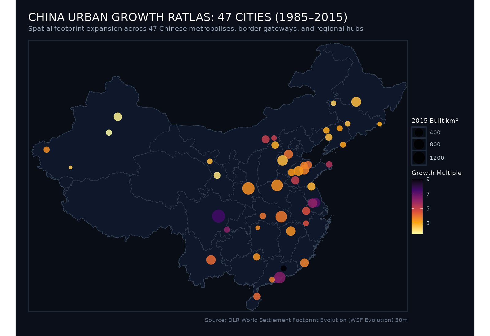
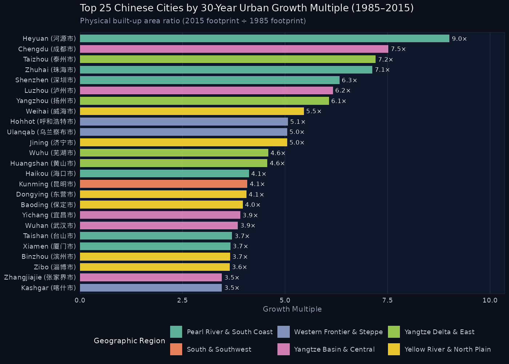

::: {.hero-banner}

  <h1 class="hero-title">China Urban Growth Ratlas</h1>
  <h2 style="color: #f59e0b; font-size: 1.5rem; margin-top: -0.25rem; margin-bottom: 1rem;">中国城市空间扩展图集 · 1985–2015</h2>
  

    Between 1985 and 2015, the People's Republic of China underwent the largest, fastest physical urbanization process in human history. 
    This ratlas maps the spatial morphology, expansion rings, and quantitative growth trajectories across <strong>47 diverse Chinese cities</strong>—from southern coastal manufacturing hubs and ancient Silk Road oases to central megacities and northeast border outposts.
  

  

    <a href="cities.html" class="btn btn-primary" style="background: #0284c7; border: none; padding: 0.6rem 1.25rem; font-weight: 600;">Browse All 47 Cities →</a>
    <a href="methodology.html" class="btn btn-secondary" style="background: #1e293b; color: #cbd5e1; border: 1px solid #334155; padding: 0.6rem 1.25rem;">Methodology & Data</a>
  

:::

## Key Findings & National Overview

::: {.metric-grid}
::: {.metric-card}
::: {.metric-label}
Total Cities Analyzed
:::
::: {.metric-val}
47
:::
:::

::: {.metric-card}
::: {.metric-label}
Median Growth Multiple
:::
::: {.metric-val}
4.1×
:::
:::

::: {.metric-card}
::: {.metric-label}
Peak Growth Multiple
:::
::: {.metric-val}
9.0×
:::

Heyuan (河源市)

:::

::: {.metric-card}
::: {.metric-label}
Peak Area Expansion
:::
::: {.metric-val}
+1,356 km²
:::

Chengdu (成都市)

:::

::: {.metric-card}
::: {.metric-label}
Satellite Data Resolution
:::
::: {.metric-val}
30 meters
:::
:::
:::

---

## National Urban Expansion Map

The map below displays all 47 cities in the ratlas across China, sized by their **2015 built-up area ($km^2$)** and colored by their **30-year growth multiplier**:

::: {.map-container}

:::

---

## National Growth Multiplier Rankings

Which cities experienced the highest relative spatial expansion between 1985 and 2015?

::: {.map-container}

:::

---

## Regional Explorations

Explore the atlas by geographic macro-regions:

::: {.columns}

::: {.column width="32%"}
::: {.region-card}
### [Pearl River & South Coast](regions/coastal_south.html)
Special Economic Zones, export engines, and coastal reclaimers.
- **Cities**: Shenzhen, Zhuhai, Xiamen, Haikou, Taishan, Heyuan
[Explore Region →](regions/coastal_south.html)
:::
:::

::: {.column width="32%"}
::: {.region-card}
### [Yangtze Basin & Central](regions/yangtze_basin.html)
Inland megacities and riverine industrial corridors.
- **Cities**: Chengdu, Wuhan, Luzhou, Yichang, Nanchang, Zhangjiajie
[Explore Region →](regions/yangtze_basin.html)
:::
:::

::: {.column width="32%"}
::: {.region-card}
### [Yangtze Delta & East](regions/yangtze_delta.html)
Interconnected manufacturing clusters and canal towns.
- **Cities**: Taizhou, Yangzhou, Wuhu, Huangshan, Lianyungang
[Explore Region →](regions/yangtze_delta.html)
:::
:::

:::

::: {.columns}

::: {.column width="32%"}
::: {.region-card}
### [Yellow River & North Plain](regions/northern_plains.html)
Heavy industrial centers across the agricultural heartland.
- **Cities**: Jinan, Zhengzhou, Baoding, Shijiazhuang, Zibo...
[Explore Region →](regions/northern_plains.html)
:::
:::

::: {.column width="32%"}
::: {.region-card}
### [Northeast Rust Belt](regions/northeast.html)
Early industrial powerhouses and international border gateways.
- **Cities**: Harbin, Dandong, Fuxin, Panjin, Tieling, Hunchun...
[Explore Region →](regions/northeast.html)
:::
:::

::: {.column width="32%"}
::: {.region-card}
### [Western Frontier & Steppe](regions/western_frontier.html)
Silk Road oasis towns, highland capitals, and desert gateways.
- **Cities**: Xi'an, Lanzhou, Urumqi, Kashgar, Hotan, Hohhot...
[Explore Region →](regions/western_frontier.html)
:::
:::

:::

---

## Complete 47-City Master Index

| Rank | City | Chinese | Province | Region | 1985 Area | 2015 Area | Net Gain | Multiplier | CAGR |
|:---:|:---|:---|:---|:---|:---:|:---:|:---:|:---:|:---:|
| #1 | [Heyuan](cities/heyuan.html) | 河源市 | Guangdong | Pearl River & South Coast | 15.15 km² | 136.49 km² | +121.34 km² | **9.01×** | 7.6% |
| #2 | [Chengdu](cities/chengdu.html) | 成都市 | Sichuan | Yangtze Basin & Central | 208.06 km² | 1564.15 km² | +1356.09 km² | **7.52×** | 6.96% |
| #3 | [Taizhou](cities/taizhou.html) | 泰州市 | Jiangsu | Yangtze Delta & East | 80.81 km² | 583 km² | +502.19 km² | **7.21×** | 6.81% |
| #4 | [Zhuhai](cities/zhuhai.html) | 珠海市 | Guangdong | Pearl River & South Coast | 33.27 km² | 237.12 km² | +203.85 km² | **7.13×** | 6.77% |
| #5 | [Shenzhen](cities/shenzhen.html) | 深圳市 | Guangdong | Pearl River & South Coast | 168.35 km² | 1064.98 km² | +896.63 km² | **6.33×** | 6.34% |
| #6 | [Luzhou](cities/luzhou.html) | 泸州市 | Sichuan | Yangtze Basin & Central | 22.7 km² | 140.03 km² | +117.33 km² | **6.17×** | 6.25% |
| #7 | [Yangzhou](cities/yangzhou.html) | 扬州市 | Jiangsu | Yangtze Delta & East | 98.97 km² | 600.99 km² | +502.02 km² | **6.07×** | 6.2% |
| #8 | [Weihai](cities/weihai.html) | 威海市 | Shandong | Yellow River & North Plain | 32.87 km² | 179.59 km² | +146.72 km² | **5.46×** | 5.82% |
| #9 | [Hohhot](cities/hohhot.html) | 呼和浩特市 | Inner Mongolia | Western Frontier & Steppe | 68.88 km² | 349.27 km² | +280.39 km² | **5.07×** | 5.56% |
| #10 | [Jining](cities/jining.html) | 济宁市 | Shandong | Yellow River & North Plain | 77.41 km² | 391.12 km² | +313.71 km² | **5.05×** | 5.55% |
| #11 | [Ulanqab](cities/ulanqab.html) | 乌兰察布市 | Inner Mongolia | Western Frontier & Steppe | 20.59 km² | 103.9 km² | +83.31 km² | **5.05×** | 5.54% |
| #12 | [Wuhu](cities/wuhu.html) | 芜湖市 | Anhui | Yangtze Delta & East | 82.97 km² | 380.45 km² | +297.48 km² | **4.59×** | 5.21% |
| #13 | [Huangshan](cities/huangshan.html) | 黄山市 | Anhui | Yangtze Delta & East | 26.02 km² | 118.96 km² | +92.94 km² | **4.57×** | 5.2% |
| #14 | [Haikou](cities/haikou.html) | 海口市 | Hainan | Pearl River & South Coast | 63.84 km² | 262.73 km² | +198.89 km² | **4.12×** | 4.83% |
| #15 | [Kunming](cities/kunming.html) | 昆明市 | Yunnan | South & Southwest | 153.06 km² | 624.84 km² | +471.78 km² | **4.08×** | 4.8% |
| #16 | [Dongying](cities/dongying.html) | 东营市 | Shandong | Yellow River & North Plain | 83.9 km² | 341.04 km² | +257.14 km² | **4.06×** | 4.79% |
| #17 | [Baoding](cities/baoding.html) | 保定市 | Hebei | Yellow River & North Plain | 132.36 km² | 526.12 km² | +393.76 km² | **3.97×** | 4.71% |
| #18 | [Yichang](cities/yichang.html) | 宜昌市 | Hubei | Yangtze Basin & Central | 45.63 km² | 178.59 km² | +132.96 km² | **3.91×** | 4.65% |
| #19 | [Wuhan](cities/wuhan.html) | 武汉市 | Hubei | Yangtze Basin & Central | 279.63 km² | 1077.9 km² | +798.27 km² | **3.85×** | 4.6% |
| #20 | [Taishan](cities/taishan.html) | 台山市 | Guangdong | Pearl River & South Coast | 30.28 km² | 112.33 km² | +82.05 km² | **3.71×** | 4.47% |
| #21 | [Xiamen](cities/xiamen.html) | 厦门市 | Fujian | Pearl River & South Coast | 128.93 km² | 473.04 km² | +344.11 km² | **3.67×** | 4.43% |
| #22 | [Binzhou](cities/binzhou.html) | 滨州市 | Shandong | Yellow River & North Plain | 75.53 km² | 276.66 km² | +201.13 km² | **3.66×** | 4.42% |
| #23 | [Zibo](cities/zibo.html) | 淄博市 | Shandong | Yellow River & North Plain | 180.8 km² | 660.67 km² | +479.87 km² | **3.65×** | 4.41% |
| #24 | [Kashgar](cities/kashgar.html) | 喀什市 | Xinjiang | Western Frontier & Steppe | 46.39 km² | 160.73 km² | +114.34 km² | **3.46×** | 4.23% |
| #25 | [Zhangjiajie](cities/zhangjiajie.html) | 张家界市 | Hunan | Yangtze Basin & Central | 18.13 km² | 62.73 km² | +44.6 km² | **3.46×** | 4.22% |
| #26 | [Xi'an](cities/xian.html) | 西安市 | Shaanxi | Western Frontier & Steppe | 392.14 km² | 1354.03 km² | +961.89 km² | **3.45×** | 4.22% |
| #27 | [Zhengzhou](cities/zhengzhou.html) | 郑州市 | Henan | Yellow River & North Plain | 315.56 km² | 1084.55 km² | +768.99 km² | **3.44×** | 4.2% |
| #28 | [Nanchang](cities/nanchang.html) | 南昌市 | Jiangxi | Yangtze Basin & Central | 178.79 km² | 608.57 km² | +429.78 km² | **3.4×** | 4.17% |
| #29 | [Guilin](cities/guilin.html) | 桂林市 | Guangxi | South & Southwest | 76.14 km² | 254.1 km² | +177.96 km² | **3.34×** | 4.1% |
| #30 | [Liaocheng](cities/liaocheng.html) | 聊城市 | Shandong | Yellow River & North Plain | 86.36 km² | 279.69 km² | +193.33 km² | **3.24×** | 3.99% |
| #31 | [Jinan](cities/jinan.html) | 济南市 | Shandong | Yellow River & North Plain | 200.11 km² | 647.13 km² | +447.02 km² | **3.23×** | 3.99% |
| #32 | [Dandong](cities/dandong.html) | 丹东市 | Liaoning | Northeast Rust Belt | 45.2 km² | 140.92 km² | +95.72 km² | **3.12×** | 3.86% |
| #33 | [Tieling](cities/tieling.html) | 铁岭市 | Liaoning | Northeast Rust Belt | 43.68 km² | 134.96 km² | +91.28 km² | **3.09×** | 3.83% |
| #34 | [Hunchun](cities/hunchun.html) | 珲春市 | Jilin | Northeast Rust Belt | 20.56 km² | 61.52 km² | +40.96 km² | **2.99×** | 3.72% |
| #35 | [Fuxin](cities/fuxin.html) | 阜新市 | Liaoning | Northeast Rust Belt | 57.66 km² | 169.39 km² | +111.73 km² | **2.94×** | 3.66% |
| #36 | [Datong](cities/datong.html) | 大同市 | Shanxi | Yellow River & North Plain | 99.39 km² | 279.67 km² | +180.28 km² | **2.81×** | 3.51% |
| #37 | [Lianyungang](cities/lianyungang.html) | 连云港市 | Jiangsu | Yangtze Delta & East | 135.75 km² | 369.04 km² | +233.29 km² | **2.72×** | 3.39% |
| #38 | [Wuwei](cities/wuwei.html) | 武威市 | Gansu | Western Frontier & Steppe | 40.73 km² | 108.55 km² | +67.82 km² | **2.67×** | 3.32% |
| #39 | [Shijiazhuang](cities/shijiazhuang.html) | 石家庄市 | Hebei | Yellow River & North Plain | 307.22 km² | 811.55 km² | +504.33 km² | **2.64×** | 3.29% |
| #40 | [Harbin](cities/harbin.html) | 哈尔滨市 | Heilongjiang | Northeast Rust Belt | 267.74 km² | 701.48 km² | +433.74 km² | **2.62×** | 3.26% |
| #41 | [Panjin](cities/panjin.html) | 盘锦市 | Liaoning | Northeast Rust Belt | 98.33 km² | 254.37 km² | +156.04 km² | **2.59×** | 3.22% |
| #42 | [Liaoyuan](cities/liaoyuan.html) | 辽源市 | Jilin | Northeast Rust Belt | 44.37 km² | 111.94 km² | +67.57 km² | **2.52×** | 3.13% |
| #43 | [Hotan](cities/hotan.html) | 和田市 | Xinjiang | Western Frontier & Steppe | 19.4 km² | 46.43 km² | +27.03 km² | **2.39×** | 2.95% |
| #44 | [Baicheng](cities/baicheng.html) | 白城市 | Jilin | Northeast Rust Belt | 43.41 km² | 98.62 km² | +55.21 km² | **2.27×** | 2.77% |
| #45 | [Lanzhou](cities/lanzhou.html) | 兰州市 | Gansu | Western Frontier & Steppe | 119.22 km² | 232.72 km² | +113.5 km² | **1.95×** | 2.25% |
| #46 | [Urumqi](cities/urumqi.html) | 乌鲁木齐市 | Xinjiang | Western Frontier & Steppe | 251.96 km² | 431.36 km² | +179.4 km² | **1.71×** | 1.81% |
| #47 | [Korla](cities/korla.html) | 库尔勒市 | Xinjiang | Western Frontier & Steppe | 102.96 km² | 156.53 km² | +53.57 km² | **1.52×** | 1.41% |

---

::: {.caption-box}
**China Urban Growth Ratlas** · Built with R (`terra`, `sf`, `ggplot2`, `tidyterra`, `patchwork`) and Quarto. Data: German Aerospace Center (DLR) World Settlement Footprint Evolution (30m) & GADM 4.1.
:::
