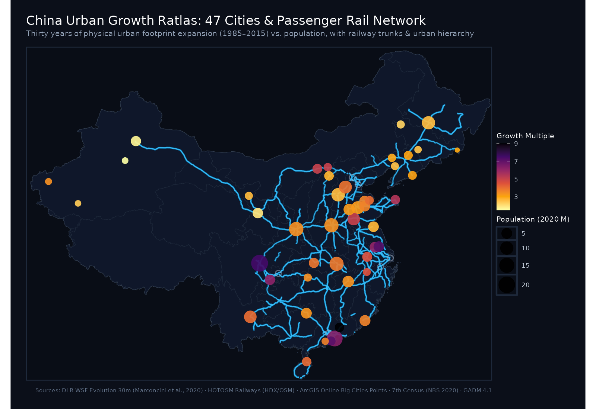
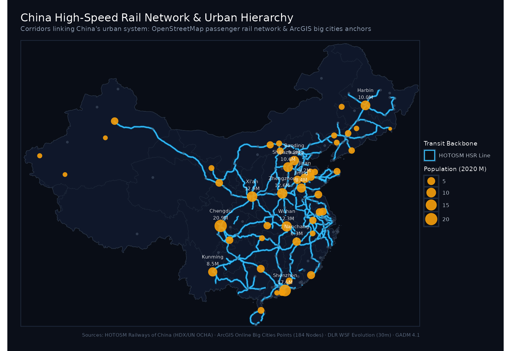
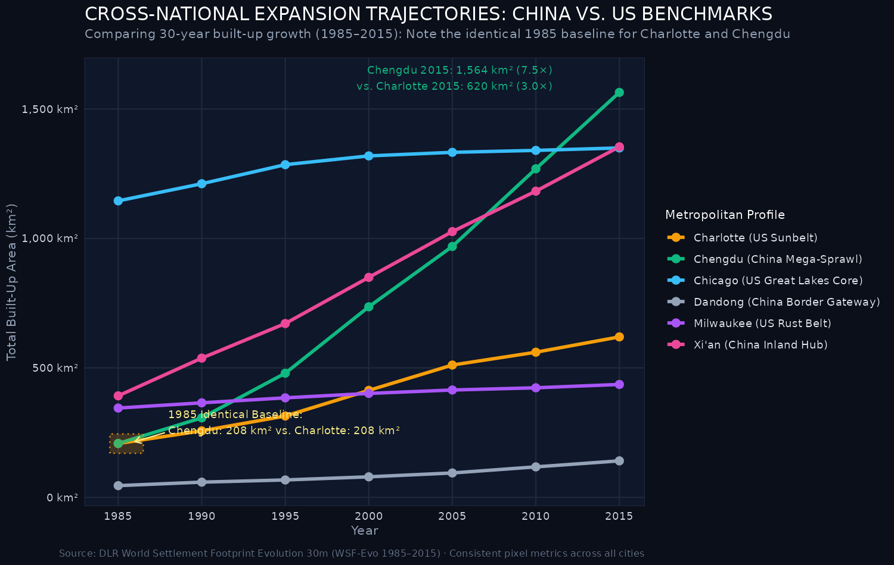
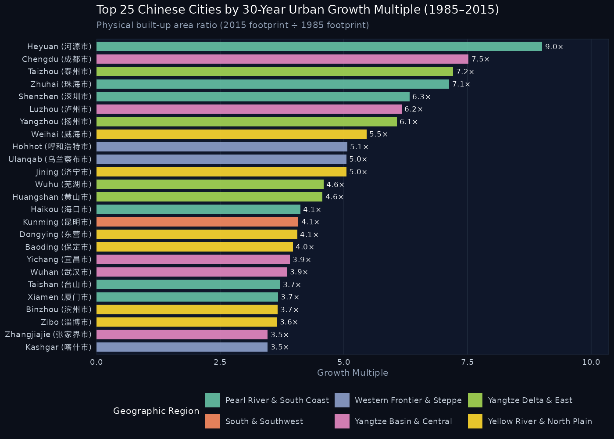
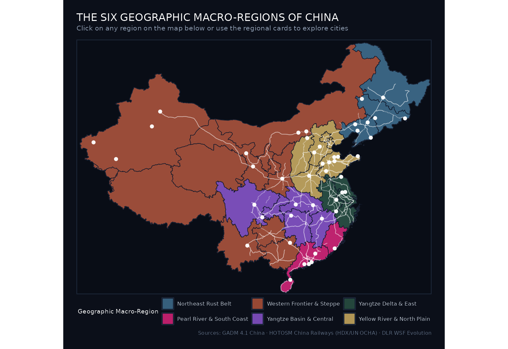

```{=html}
<div class="hero-banner">
  <div style="max-width: 900px;">
    <h1 class="hero-title">China Urban Growth Ratlas</h1>
    <h2 style="color: #1e3f34; font-size: 1.4rem; margin-top: -0.25rem; margin-bottom: 1rem; font-weight: normal; font-style: normal;">中国城市空间扩展图集 · 1985–2015</h2>
    <p class="hero-subtitle">
      Between 1985 and 2015, the People's Republic of China underwent the largest physical urbanization process in human history. 
      This ratlas maps the spatial morphology, expansion rings, China Railway (12306) and municipal subway networks, and quantitative growth trajectories across <strong>47 diverse Chinese cities</strong> ranked by population, with global benchmarks in <strong>Chicago, Milwaukee, and Charlotte</strong>, accompanied by historical map plates from the <strong>American Geographical Society Library (AGSL)</strong>.
    </p>
    <div style="display: flex; gap: 0.75rem; margin-top: 1.5rem; flex-wrap: wrap;">
      <a href="cities.html" class="resource-btn" style="background: #943324; color: #fff; border-color: #943324; font-weight: 600;">Browse all 47 cities →</a>
      <a href="comparison.html" class="resource-btn" style="background: #1e3f34; color: #fff; border-color: #1e3f34; font-weight: 600;">US comparisons (Chicago, Milwaukee, Charlotte) →</a>
      <a href="https://drive.google.com/drive/folders/1b-HupghVS7KQn4ZTvGjfOHFFMgPnH2KV?usp=sharing" target="_blank" rel="noopener" class="resource-btn" style="background: #e8ded1; border-color: #943324; font-weight: 600;">AGSL historical map scans (Google Drive) ↗</a>
      <a href="methodology.html" class="resource-btn">Methodology & citations</a>
    </div>
  </div>
</div>
```

::: {.callout-note appearance="simple" icon=true}
## Scope & sample selection: Excluding Tier-1 superstar megacities
The 47 cities in this atlas were deliberately selected to **exclude China's absolute largest tier-1 megacities** (specifically Beijing, Shanghai, Guangzhou, Chongqing, and Tianjin).

By centering on dynamic provincial capitals (e.g., Chengdu, Wuhan, Xi'an, Zhengzhou), specialized manufacturing nodes (e.g., Shenzhen, Zhuhai, Taizhou, Zibo), ancient Silk Road oases (e.g., Kashgar, Hotan, Wuwei), and strategic border gateways (e.g., Dandong, Hunchun), this ratlas examines how physical urbanization and infrastructure modernization transformed the full depth of China's urban hierarchy beyond the global superstar metropolises.
:::

## 1. National urban expansion & passenger rail network

The map below displays all 47 cities in the ratlas across China, sized by **2020 Census Population**, colored by **30-year growth multiplier**, overlaid with the **HOTOSM China Railways dataset (HDX)** and contextualized with **ArcGIS Online Big Cities Points**:

::: {.map-container}

:::

---

## 2. Archival map plates & historical scans

```{=html}
<div class="agsl-box">
  <div class="agsl-title">Archival cartography: AGSL historical map collection</div>
  <div class="agsl-desc">
    This monograph integrates a dedicated curated selection of high-resolution historical scans from the <strong>American Geographical Society Library (AGSL)</strong>, featuring city guides, early Republican plans, British War Office surveys, and late-twentieth-century municipal transit maps for Chengdu, Harbin, Jinan, Kashgar, Korla, Lanzhou, Shijiazhuang, Urumqi, Weihai, Wuhan, Xiamen, and Xi'an.
  </div>
  <div style="display: flex; gap: 0.75rem; flex-wrap: wrap;">
    <a href="https://drive.google.com/drive/folders/1b-HupghVS7KQn4ZTvGjfOHFFMgPnH2KV?usp=sharing" target="_blank" rel="noopener" class="resource-btn" style="background: #943324; color: #fff; font-weight: 600;">Browse all 67 AGSL scans on Google Drive ↗</a>
    <a href="cities/harbin.html" class="resource-btn">Harbin historical plates (1946–2001) →</a>
    <a href="cities/xian.html" class="resource-btn">Xi'an historical surveys (1986–2000) →</a>
    <a href="cities/chengdu.html" class="resource-btn">Chengdu Michelin & snack maps →</a>
  </div>
</div>
```

---

## 3. High-speed rail network & urban hierarchy

China's High-Speed Rail grid physically stitched together regional capitals and secondary nodes, accelerating post-2005 outward expansion across the 184 major urban centers identified in the ArcGIS Online Big Cities layer:

::: {.map-container}

:::

---

## 4. Key findings & national overview

::: {.metric-grid}
::: {.metric-card}
::: {.metric-label}
Total Chinese Cities
:::
::: {.metric-val}
47
:::
<div style="font-size: 0.8rem; color: #943324;">Ranked by Population</div>
:::

::: {.metric-card}
::: {.metric-label}
Largest City (2020)
:::
::: {.metric-val}
20.9 <span style="font-size: 1rem;">M</span>
:::
<div style="font-size: 0.8rem; color: #1e3f34;">Chengdu (成都市)</div>
:::

::: {.metric-card}
::: {.metric-label}
Peak Growth Multiple
:::
::: {.metric-val}
9.0×
:::
<div style="font-size: 0.8rem; color: #1e3f34;">Heyuan (河源市)</div>
:::

::: {.metric-card}
::: {.metric-label}
Peak Area Expansion
:::
::: {.metric-val}
+1,356 <span style="font-size: 1rem;">km²</span>
:::
<div style="font-size: 0.8rem; color: #1e3f34;">Chengdu (成都市)</div>
:::

::: {.metric-card}
::: {.metric-label}
Rail & Transit
:::
::: {.metric-val}
12306 / AMap
:::
<div style="font-size: 0.8rem; color: #943324;">432 National Lines + 15 Metro Cities</div>
:::

::: {.metric-card}
::: {.metric-label}
US Benchmarks
:::
::: {.metric-val}
3 Cities
:::
<div style="font-size: 0.8rem; color: #1e3f34;">Chicago, Milwaukee, Charlotte</div>
:::
:::

---

## 5. Global points of comparison: US benchmark metropolises

How did China's 30-year urban expansion compare to Western metropolitan development? 
To establish an objective international baseline, **Milwaukee**, **Chicago**, and **Charlotte** were incorporated into the ratlas using the exact same DLR WSF Evolution 30m satellite data:

::: {.columns}

::: {.column width="32%"}
::: {.region-card}
### [Chicago (芝加哥)](cities/chicago.html)
**Mature Great Lakes Core** · Pop: **2.75M** (Metro: 9.61M)
- **1985 Footprint**: 1,145.2 km² (larger than all 47 Chinese cities in 1985)
- **2015 Footprint**: 1,349.6 km² (+204.4 km²)
- **30-Year Multiplier**: <strong style="color: #943324;">1.18×</strong> (CAGR: 0.55%)
- **Comparative Peer**: Xi'an / Wuhan

[Explore Chicago Maps & Analytics →](cities/chicago.html)
:::
:::

::: {.column width="32%"}
::: {.region-card}
### [Milwaukee (密尔沃基)](cities/milwaukee.html)
**Great Lakes Rust Belt** · Pop: **0.58M** (Metro: 1.57M)
- **1985 Footprint**: 344.9 km² (comparable to Xi'an / Zhengzhou)
- **2015 Footprint**: 436.1 km² (+91.2 km²)
- **30-Year Multiplier**: <strong style="color: #943324;">1.26×</strong> (CAGR: 0.78%)
- **Comparative Peer**: Northeast Rust Belt (Fuxin / Dandong)

[Explore Milwaukee Maps & Analytics →](cities/milwaukee.html)
:::
:::

::: {.column width="32%"}
::: {.region-card}
### [Charlotte (夏洛特)](cities/charlotte.html)
**Sunbelt Boomtown** · Pop: **0.87M** (Metro: 2.66M)
- **1985 Footprint**: 208.0 km² (virtually identical to Chengdu: 208.1 km²)
- **2015 Footprint**: 619.8 km² (+411.8 km²)
- **30-Year Multiplier**: <strong style="color: #1e3f34;">2.98×</strong> (CAGR: 3.71%)
- **Comparative Peer**: Chengdu (7.52× vs. Charlotte 2.98×)

[Explore Charlotte Maps & Analytics →](cities/charlotte.html)
:::
:::

:::

::: {.map-container}

:::

[Read the Complete Cross-National Analysis in the US Comparisons Chapter →](comparison.html)

---

## 6. Thirty-year growth multiplier rankings

Which cities experienced the highest relative spatial expansion between 1985 and 2015?

::: {.map-container}

:::

---

## 7. Interactive regional explorations

Select any region on the interactive map below to jump directly to its dedicated regional chapter, or explore via the region cards below:

```{=html}
<div style="position: relative; width: 100%; max-width: 1100px; margin: 1.5rem auto; border-radius: 4px; overflow: hidden; border: 1px solid #d6ccbe; box-shadow: 0 4px 14px rgba(34,29,26,0.1);">
  <!-- Base Regional Map Graphic -->
  

  <!-- Interactive SVG Clickable Overlay with Glowing Regions -->
  <svg viewBox="0 0 1600 1100" style="position: absolute; top: 0; left: 0; width: 100%; height: 100%; pointer-events: auto;">
    <style>
      .reg-link { cursor: pointer; transition: all 0.25s ease; }
      .reg-poly { fill: transparent; stroke: transparent; stroke-width: 3; transition: all 0.25s ease; }
      .reg-link:hover .reg-poly { fill: rgba(148, 51, 36, 0.25); stroke: #943324; }
      .reg-link text { fill: #ffffff; font-size: 26px; font-weight: bold; text-anchor: middle; pointer-events: none; opacity: 0.95; text-shadow: 0 2px 6px rgba(0,0,0,0.9); font-family: "Hoefler Text", Georgia, serif; }
    </style>

    <!-- Northeast Rust Belt -->
    <a href="regions/northeast.html" class="reg-link" title="Northeast Rust Belt (8 Cities)">
      <polygon class="reg-poly" points="1160,80 1560,80 1560,420 1200,450 1160,350" />
      <text x="1350" y="240">Northeast Rust Belt →</text>
    </a>

    <!-- Yellow River & North Plain -->
    <a href="regions/northern_plains.html" class="reg-link" title="Yellow River & North Plain (11 Cities)">
      <polygon class="reg-poly" points="960,380 1260,380 1260,600 960,600" />
      <text x="1110" y="490">North Plain & Bohai →</text>
    </a>

    <!-- Yangtze Delta & East -->
    <a href="regions/yangtze_delta.html" class="reg-link" title="Yangtze Delta & East (5 Cities)">
      <polygon class="reg-poly" points="1090,560 1260,560 1260,730 1090,730" />
      <text x="1180" y="650">Yangtze Delta →</text>
    </a>

    <!-- Yangtze Basin & Central -->
    <a href="regions/yangtze_basin.html" class="reg-link" title="Yangtze Basin & Central (6 Cities)">
      <polygon class="reg-poly" points="760,590 1100,590 1100,780 760,780" />
      <text x="930" y="690">Yangtze Basin & Central →</text>
    </a>

    <!-- Pearl River & South Coast -->
    <a href="regions/coastal_south.html" class="reg-link" title="Pearl River & South Coast (6 Cities)">
      <polygon class="reg-poly" points="890,780 1230,780 1230,1020 890,1020" />
      <text x="1060" y="900">Pearl River & South Coast →</text>
    </a>

    <!-- Western Frontier & Steppe -->
    <a href="regions/western_frontier.html" class="reg-link" title="Western Frontier & Steppe (11 Cities)">
      <polygon class="reg-poly" points="50,180 960,180 820,950 50,700" />
      <text x="480" y="460">Western Frontier & Steppe →</text>
    </a>
  </svg>

  <!-- Standard HTML5 Image Map Fallback -->
  <map name="chinaregions">
    <area shape="poly" coords="1160,80,1560,80,1560,420,1200,450,1160,350" href="regions/northeast.html" alt="Northeast Rust Belt">
    <area shape="poly" coords="960,380,1260,380,1260,600,960,600" href="regions/northern_plains.html" alt="Yellow River & North Plain">
    <area shape="poly" coords="1090,560,1260,560,1260,730,1090,730" href="regions/yangtze_delta.html" alt="Yangtze Delta & East">
    <area shape="poly" coords="760,590,1100,590,1100,780,760,780" href="regions/yangtze_basin.html" alt="Yangtze Basin & Central">
    <area shape="poly" coords="890,780,1230,780,1230,1020,890,1020" href="regions/coastal_south.html" alt="Pearl River & South Coast">
    <area shape="poly" coords="50,180,960,180,820,950,50,700" href="regions/western_frontier.html" alt="Western Frontier & Steppe">
  </map>
</div>
```

::: {.columns}

::: {.column width="32%"}
::: {.region-card}
### [Pearl River & South Coast](regions/coastal_south.html)
Special Economic Zones, export engines, and coastal reclaimers.
- **Cities**: Shenzhen, Xiamen, Haikou, Heyuan, Zhuhai, Taishan
[Explore Region →](regions/coastal_south.html)
:::
:::

::: {.column width="32%"}
::: {.region-card}
### [Yangtze Basin & Central](regions/yangtze_basin.html)
Inland megacities and riverine industrial corridors.
- **Cities**: Chengdu, Wuhan, Nanchang, Luzhou, Yichang, Zhangjiajie
[Explore Region →](regions/yangtze_basin.html)
:::
:::

::: {.column width="32%"}
::: {.region-card}
### [Yangtze Delta & East](regions/yangtze_delta.html)
Interconnected manufacturing clusters and canal towns.
- **Cities**: Lianyungang, Yangzhou, Taizhou, Wuhu, Huangshan
[Explore Region →](regions/yangtze_delta.html)
:::
:::

:::

::: {.columns}

::: {.column width="32%"}
::: {.region-card}
### [Yellow River & North Plain](regions/northern_plains.html)
Heavy industrial centers across the agricultural heartland.
- **Cities**: Zhengzhou, Shijiazhuang, Baoding, Jinan, Jining, Liaocheng...
[Explore Region →](regions/northern_plains.html)
:::
:::

::: {.column width="32%"}
::: {.region-card}
### [Northeast Rust Belt](regions/northeast.html)
Early industrial powerhouses and international border gateways.
- **Cities**: Harbin, Tieling, Dandong, Fuxin, Baicheng, Panjin...
[Explore Region →](regions/northeast.html)
:::
:::

::: {.column width="32%"}
::: {.region-card}
### [Western Frontier & Steppe](regions/western_frontier.html)
Silk Road oasis towns, highland capitals, and desert gateways.
- **Cities**: Xi'an, Kunming, Guilin, Lanzhou, Urumqi, Hohhot, Kashgar...
[Explore Region →](regions/western_frontier.html)
:::
:::

:::

---

## 8. Primary data sources & citations

This atlas synthesizes open geospatial and authoritative statistical datasets. Detailed academic citations, licensing terms, and analytical documentation are available in the [Methodology & Citations](methodology.html) chapter.

| Dataset / Source | Custodian / Provider | Resolution / Coverage | Analytical Role in Ratlas | Primary Citation / Access |
|:---|:---|:---|:---|:---|
| **World Settlement Footprint Evolution (WSF Evolution)** | German Aerospace Center (DLR) | 30m / 1985–2015 Annual | Primary spatial engine; identifies exact year of settlement detection | [DLR Geoservice](https://download.geoservice.dlr.de/WSF_EVO/) · Marconcini et al. (2020, *Sci. Data*) |
| **National Railways (12306 / NRA)** | China Railway & National Railway Administration | Vector / 432 Lines, 3,300 Stations | National passenger rail backbone, high-speed lines & stations | China Railway 12306 Service System & NRA (2024) |
| **City Subway Systems (AMap)** | AMap (高德地图) & MOT PRC | Vector / 15 Cities | Rapid transit network lines & stations for all metro-served cities | [AMap Subway Platform](http://map.amap.com/subway/index.html) · Ministry of Transport |
| **Big Cities Points Layer** | Esri / ArcGIS Online | Vector Points / 184 Cities | National city hierarchy ranking (1–200) and tier-1 anchor points | [ArcGIS FeatureServer](https://services1.arcgis.com/4TXrdeWh0RyCqPgB/arcgis/rest/services/big_cities_points/FeatureServer) |
| **Seventh National Population Census (七普 2020)** | National Bureau of Statistics of China (NBS) | Prefectural / 2020 | Primary ranking order (#1–#47) by permanent resident population | [NBS China Census Bulletin (2021)](http://www.stats.gov.cn/) |
| **AGSL Historical Map Archive** | American Geographical Society Library (AGSL) | Scanned Sheets / High-Res | Archival ground-truth topographic sheets and municipal town plans | [AGSL Collection (Google Drive)](https://drive.google.com/drive/folders/1b-HupghVS7KQn4ZTvGjfOHFFMgPnH2KV?usp=sharing) |
| **US Decennial Census (2020)** | U.S. Census Bureau | Municipal & Metro / 2020 | Population benchmarks for Chicago, Milwaukee, and Charlotte | [U.S. Census Bureau](https://www.census.gov/) |
| **North America Railroads (10m)** | Natural Earth Vector | Vector / Continental | Rail networks for US comparison benchmark cities | [Natural Earth](https://www.naturalearthdata.com/) |
| **GADM Administrative Areas (v4.1)** | University of California, Davis (UCD) | Levels 0, 1, 2 / National | Administrative boundary clipping and bilingual toponymy | [GADM v4.1](https://gadm.org/) · Hijmans et al. (2022) |

---

::: {.caption-box}
**China Urban Growth Ratlas** · Built with R (`terra`, `sf`, `ggplot2`, `tidyterra`, `patchwork`) and Quarto. Data: German Aerospace Center (DLR) World Settlement Footprint Evolution (30m), 7th National Population Census (七普 2020), U.S. Census Bureau (2020), China Railway 12306 Network (NRA), AMap (高德地图) Subway Platform, Natural Earth, American Geographical Society Library (AGSL), ArcGIS Online Big Cities Points & GADM 4.1.
:::
